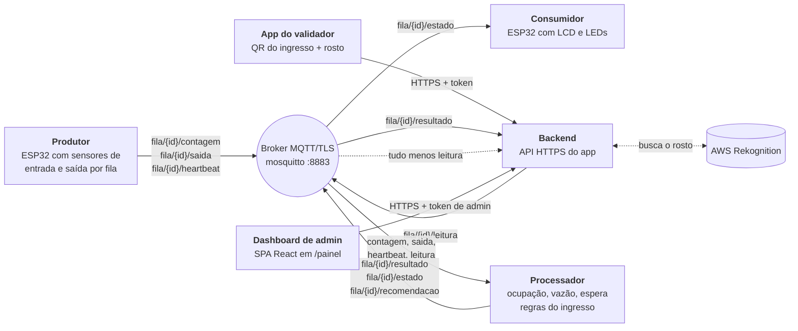

# Grupo Leite de Pedra: Caio Castro Miranda, João Pedro de Brito Tomé, João Victor Braga e Jaime da Cruz

# Marco 3 — balanceamento seguro de filas de entrada

O sistema conta quem entra e quem sai de cada fila de entrada de um evento,
estima o tempo de espera e sinaliza num semáforo (verde, amarelo, vermelho)
qual fila procurar, para que um pico de chegada se distribua em vez de
empilhar numa fila só. Na catraca, a pessoa é identificada pelo rosto: o
backend compara a foto com a coleção do AWS Rekognition, e o processador
decide se o ingresso vale.

## Estrutura do repositório

| Pasta | O que é |
|---|---|
| [`produtor/`](produtor/) | Firmware dos ESP32 simulados no Wokwi: o ESP32 das filas com um sensor na entrada e outro na saída de cada fila (`src/main.cpp`), o consumidor com LCD e LEDs (`src/consumidor.cpp`, circuito em `consumidor/`) e o intruso sem credencial (`intruso/`). Também traz `preparar-wokwi.py`, que grava as senhas no firmware. |
| [`validador/`](validador/) | Leitura facial na catraca: envia a leitura ao processador e mostra se a pessoa foi aceita. Hoje é uma página local (`index.html`) servida por `servidor.py` que simula a câmera; será substituída pela aplicação mobile. |
| [`broker/`](broker/) | Broker MQTT Mosquitto: configuração TLS, ACL por papel e scripts para gerar credenciais, iniciar o broker e testar a autorização. |
| [`banco/`](banco/) | TimescaleDB em Docker: esquema (hypertables e agregados por minuto), papéis do banco, TLS e scripts para gerar credenciais e subir o banco. |
| [`processador/`](processador/) | Serviço que consome os movimentos dos sensores e as leituras faciais, calcula ocupação, vazão e espera, aplica as regras do ingresso e publica o estado de cada fila e o resultado de cada leitura. |
| [`admin/`](admin/) | Dashboard web de administração (React + Vite + TypeScript). Mostra todos os dados (filas ao vivo, histórico, usuários, ingressos, leituras com foto, movimentos, estados e auditoria) e permite trocar papéis e cancelar ingressos. O build é servido pelo backend em `/painel/`. |
| [`mobile/`](mobile/) | App do usuário (Expo, Expo Router, TypeScript): criar conta com a foto do rosto, entrar, comprar ingressos e mostrar o QR do ingresso na catraca. Como rodar em [`mobile/README.md`](mobile/README.md). |
| [`observabilidade/`](observabilidade/) | Monitoramento: assina tudo no broker e lê o histórico do banco, os dois como `observador` e só leitura; não grava nada. Serve uma API interna (ao vivo e histórico) que o backend repassa ao dashboard, conferindo o admin. |
| [`backend/`](backend/) | API HTTPS do app (FastAPI): cadastro com login, senha e rosto, compra de ingressos e leitura na catraca pelos validadores. Reconhece o rosto no Rekognition, publica as leituras no MQTT e devolve o resultado do processador. |
| [`tests/`](tests/) | Testes automatizados (`python3 -m unittest discover -s tests`). |
| [`entregas/`](entregas/) | Entregas da disciplina; ver [Entregas](#entregas). |

O fluxo completo, com diagramas, está em [`ARQUITETURA.md`](docs/ARQUITETURA.md).

Na raiz ficam os módulos Python compartilhados: `mqtt_config.py` (conexão
TLS autenticada usada por todos os clientes), `modelos.py` (modelos SQLAlchemy
das tabelas e conexão por papel), `estado_filas.py` (saldo das filas,
histórico e decisão das leituras, sobre o ORM) e `senhas.py` (hash scrypt).

## Fluxo



1. O **produtor** detecta pelos HC-SR04 quem entra (`contagem`) e quem sai (`saida`) de cada fila e publica também o heartbeat.
2. O **validador**, logado no app, lê o QR do ingresso e captura o rosto. O **backend** busca o rosto no Rekognition, guarda a foto no S3 e publica a `leitura` com o ingresso, o id do validador, a referência da foto e o usuário reconhecido.
3. O **processador** mantém o saldo no TimescaleDB a partir dos sensores, mede a vazão pelas saídas e estima a espera. Para cada leitura, confere no banco se quem enviou é validador e se o usuário reconhecido é o dono do ingresso; publica o `resultado`: `aceito`, `recusado` ou `indeterminado`.
4. O **backend** devolve o resultado ao app, e o validador libera ou barra a pessoa; o **consumidor** acende LEDs e LCD indicando a fila com menor espera; os **admins** acompanham tudo pelo dashboard, que o backend alimenta com o que chega do broker (menos as leituras) e com o banco.

A ocupação depende só dos sensores: uma pessoa recusada ou que desiste
continua sendo contada até passar pelo sensor de saída. O reconhecimento
decide quem passa, não quantos estão na fila.

O Wokwi não executa dois microcontroladores no mesmo projeto. Por isso há
dois circuitos (`produtor/diagram.json` e `produtor/consumidor/diagram.json`),
abertos em duas instâncias da simulação. Eles se comunicam pelo broker local,
não por fios entre as placas.

| Componente | Publica | Assina |
|---|---|---|
| `produtor/src/main.cpp` (`produtor`) | `fila/{id}/contagem`, `fila/{id}/saida`, `fila/{id}/heartbeat` | — |
| `produtor/src/consumidor.cpp` (`consumidor`) | `fila/{id}/reacao` | `fila/+/estado`, `fila/+/resultado` |
| `backend/` (`backend`) | `fila/{id}/leitura` | `fila/+/resultado` (a resposta da catraca) |
| `observabilidade/` (`observador`) | — | tudo em `fila/+/+`, `sistema/+/status` e `sistema/+/rejeitado` |
| `validador/servidor.py` (`validador`, console da demo) | — | `fila/+/resultado`, `fila/+/estado` |
| `processador/processador.py` | `fila/{id}/resultado`, `fila/{id}/estado`, `fila/{id}/recomendacao` | `fila/+/contagem`, `fila/+/saida`, `fila/+/heartbeat`, `fila/+/leitura` |

Na demonstração Wokwi, `{id}` é `fila-a` ou `fila-b`.

## Payloads

Todos são JSON.

Todas as mensagens usam o mesmo envelope (`event_id`, `correlation_id`,
`event_type`, `source`, `timestamp` em ms e `payload`), descrito em
[Contrato das mensagens](docs/ARQUITETURA.md#contrato-das-mensagens). Abaixo, o
`payload` de cada tópico; o primeiro exemplo mostra o envelope inteiro.

### Telemetria (produtor → processador e dashboard)

`timestamp` é o instante em que o evento aconteceu, do relógio do ESP32
sincronizado inicialmente por NTP. O ESP32 atribui um `event_id` único a cada
movimento (que abre a própria operação: `correlation_id` igual) e o backend, a
cada leitura. O processador ignora eventos repetidos pelo MQTT.

**`fila/{id}/contagem`** — o sensor de entrada detectou uma pessoa entrando na fila.

```json
{"event_id": "esp32-abc-41", "correlation_id": "esp32-abc-41", "event_type": "contagem",
 "source": "produtor", "timestamp": 1758200000000, "payload": {"filaId": "fila-a", "sequence": 41}}
```

**`fila/{id}/saida`** — o sensor de saída detectou uma pessoa deixando a fila.
É o que reduz a ocupação e mede a vazão. `payload`: `{"filaId": "fila-a", "sequence": 42}`.

**`fila/{id}/heartbeat`** — a cada 2 s simulados, por fila. Não entra na
contagem; só prova que o enlace está vivo. O processador mede a atividade pelo
instante em que recebe o heartbeat em seu relógio monotônico, com tolerância
de 15 s reais. O `timestamp` não determina essa atividade: no Wokwi, o
relógio simulado pode avançar mais devagar que o relógio do computador.
`payload`: `{"filaId": "fila-a", "sequence": 43}`.

**`sistema/{usuario}/status`** — presença de cada componente, retida:
`{"online": true}` ao conectar e `{"online": false}` pelo Last Will, quando a
conexão cai, ou ao sair. Pela ACL, cada usuário só escreve o próprio.

**`fila/{id}/reacao`** — o Wokwi consumidor recebeu um `resultado` e executou a
reação: o LED da decisão pisca no lugar do semáforo por 4 s (verde liberar,
amarelo decidir manualmente, vermelho barrar) e o LCD mostra a decisão. A
confirmação leva o `correlation_id` da leitura e `event_id` igual a
`{event_id do resultado}-reacao`; um resultado reenviado pelo outbox é
confirmado de novo, sem repetir a reação. O consumidor não decide nada.

```json
{"filaId": "fila-a", "resultadoId": "8e7d…-resultado", "resultado": "aceito", "acao": "liberar"}
```

**`sistema/processador/rejeitado`** — cada mensagem que o processador
descartou: `{"topico", "motivo", "eventId"?, "conteudo"?}`, com `motivo` igual a
`fora-do-contrato`, `tipo-desconhecido`, `leitura-incompleta` ou `duplicado`.
O `conteudo` (até 300 bytes) só vai quando a mensagem não é uma leitura nem
segue o contrato. O dashboard mostra a contagem por motivo.

### Leitura facial (app do validador → backend → processador)

**`fila/{id}/leitura`** — a câmera da catraca capturou um rosto. Só a
referência da foto passa pelo broker: a imagem fica num bucket e nenhum outro
assinante recebe biometria. Pela ACL, só o backend publica e só o processador
lê este tópico. O backend gera o `correlation_id` da operação e já manda o
resultado do Rekognition: `reconhecimento` é `reconhecido` (com
`usuarioReconhecido`), `nao-reconhecido` ou `falha` (sem rosto na foto ou sem
resposta da AWS).

```json
{"filaId": "fila-a", "fotoRef": "leituras/8e7d2184e4f0410895e2af6da4e5e2a1.jpg", "ingressoId": "3F9A1C07B2E4", "validadorId": "5b0c…", "reconhecimento": "reconhecido", "usuarioReconhecido": "a41f…"}
```

**`fila/{id}/resultado`** — a decisão do processador para aquela leitura, com
o `correlation_id` da leitura (é por ele que o backend acha a catraca que
espera) e `event_id` igual a `{event_id da leitura}-resultado`. Ele passa pelo
outbox (tabela `saida`): é gravado junto com a decisão e publicado até o broker
confirmar, então pode chegar mais de uma vez, sempre com o mesmo `event_id`.

```json
{"filaId": "fila-a", "leituraId": "8e7d2184e4f0410895e2af6da4e5e2a1", "ingressoId": "3F9A1C07B2E4", "resultado": "recusado", "motivo": "ingresso-ja-usado"}
```

| `resultado` | Significado |
|---|---|
| `aceito` | o rosto é do dono do ingresso, que ainda não tinha sido usado; o ingresso é marcado como usado |
| `recusado` | `motivo`: `validador-nao-autorizado`, `rosto-nao-confere`, `ingresso-inexistente` ou `ingresso-ja-usado` |
| `indeterminado` | `motivo`: `falha-reconhecimento`; o operador decide manualmente |

O backend chama o `SearchFacesByImage` com a foto (semelhança mínima de 95%);
o rosto encontrado traz o `usuario_id` no `ExternalImageId`. O processador
decide em ordem: primeiro confere no banco se `validadorId` tem o papel
`validador`; depois o `reconhecimento`; por fim, se `usuarioReconhecido` é o
dono de `ingressoId` e se o ingresso não foi usado nem cancelado.
A marcação do ingresso e o resultado ficam na mesma transação. Uma leitura
reentregue pelo broker recebe a mesma resposta, sem gastar o ingresso.

### Recomendação e estado (processador → consumidor e dashboard)

**`fila/{id}/recomendacao`** — publicada só quando o par (`semaforo`, `sentidoRecomendado`) muda,
com o `correlation_id` do evento que provocou o recálculo. `payload`:

```json
{
  "filaId": "fila-a",
  "semaforo": "bloqueada",
  "ocupacao": 5,
  "sentidoRecomendado": "fila-b",
  "motivo": "fila-a está VERMELHO (34s de espera, 5 na fila); fila-b está VERDE (7s de espera, 1 na fila)",
  "tempoEsperaEstimado": 34
}
```

| Campo | Valores |
|---|---|
| `semaforo` | `livre` (verde, espera ≤ 15 s), `atencao` (amarelo, 15–30 s), `bloqueada` (vermelho, > 30 s) |
| `ocupacao` | entradas − saídas registradas pelos sensores |
| `sentidoRecomendado` | a própria fila (permanecer) ou a fila para onde desviar |
| `motivo` | texto explicando a decisão |
| `tempoEsperaEstimado` | segundos; `null` se a espera ficar indeterminada (por exemplo, ninguém saindo da fila) |

**`fila/{id}/estado`** contém `filaId`, `semaforo`, `ocupacao`,
`sentidoRecomendado` e `tempoEsperaEstimado`. É publicado com QoS 1 e `retain`
para que o consumidor recupere o estado ao reconectar. A ocupação e o
histórico ficam no TimescaleDB.
Antes de o sensor de saída registrar duas passagens, a espera usa 7 s por pessoa; depois passa a
usar a vazão observada. Assim o semáforo já reage ao crescimento da fila.

## Como rodar

### Segurança

Cada componente possui uma identidade MQTT diferente. O broker autentica essas
identidades por senha e aplica o princípio do menor privilégio por meio de ACLs:

| Identidade | Permissões |
|---|---|
| `produtor` | publica entradas, saídas e heartbeat |
| `consumidor` | somente lê o estado das filas |
| `processador` | lê movimentos e leituras faciais; publica resultados, estados e recomendações |
| `observador` | somente lê, tudo; usado pela observabilidade (que descarta a referência da foto das leituras) e para inspecionar o broker (`mosquitto_sub`, `testar-acl.py`) |
| `validador` | console da demo: lê resultados e o estado das filas |
| `backend` | publica as leituras dos validadores do app; lê todo o resto (menos leituras) para o dashboard |

O listener sem criptografia foi removido. Toda comunicação usa MQTT sobre TLS na
porta 8883, e os clientes validam o certificado do broker usando a CA local.
Senhas, chaves privadas e certificados de desenvolvimento ficam em
`.local/mqtt` e `.local/banco`, diretórios ignorados pelo Git.

O banco segue as mesmas regras (ver
[regras obrigatórias](docs/ARQUITETURA.md#regras-obrigatórias-de-segurança)):

| Papel no banco | Permissões |
|---|---|
| `processador` | lê e grava saldo, movimentos e estados; lê ingressos e só marca a entrada; não apaga nada nem cria tabelas |
| `backend` | rotas do app: cadastra clientes (sem escolher o papel) e emite ingressos novos; não marca entrada nem apaga |
| `painel` | rotas do dashboard: lê tudo menos as senhas; só escreve o papel dos usuários, o cancelamento de ingressos e a auditoria; não apaga |
| `postgres` | só dentro do contêiner, para criar o esquema; não entra pela rede |

O TimescaleDB escuta só em `127.0.0.1:5433`, aceita apenas TLS (1.2 ou
superior) com senha SCRAM e usa um certificado assinado pela mesma CA do broker;
os clientes conectam com `sslmode=verify-full`. A telemetria do TimescaleDB
fica desligada. O validador não tem acesso ao banco: a ocupação que ele mostra
vem do estado publicado pelo processador.

### Preparação

Instale as dependências uma vez:

```
sudo apt install mosquitto mosquitto-clients openssl docker.io docker-compose-v2
python3 -m venv .venv && .venv/bin/pip install -r requirements.txt
```

No macOS, use `brew install mosquitto colima docker docker-compose` e
`colima start`. Rode os comandos Python com `.venv/bin/python` (ou ative o
ambiente com `source .venv/bin/activate`).

Gere a CA, o certificado de `localhost`/`host.wokwi.internal` e as cinco
credenciais aleatórias, depois prepare um cabeçalho local para cada ESP32:

```
./broker/configurar-seguranca.sh
./banco/configurar-banco.sh
./backend/configurar-backend.sh
python3 produtor/preparar-wokwi.py
```

`configurar-backend.sh` emite o certificado HTTPS do backend (app e dashboard) com a mesma CA e gera a chave que assina os tokens de sessão.

`configurar-banco.sh` usa a CA criada pelo primeiro script para emitir o
certificado do banco e gera as senhas de `admin` (o superusuário),
`processador`, `backend`, `painel` e `observador` em `.local/banco`. Um banco
criado antes do app precisa de `./banco/atualizar-banco.sh` uma vez; um criado
antes da observabilidade, de `./banco/adicionar-observador.sh` (idempotente:
cria o papel `observador`, só de leitura, e a tabela `saida`).

O script se recusa a sobrescrever uma configuração existente. Os arquivos de
senha individuais são lidos diretamente pelos clientes e têm permissão `0600`.
Os clientes usam a API de callbacks da versão 2 do Paho MQTT.
Se você já tinha a configuração anterior, execute
`./broker/configurar-seguranca.sh --adicionar-consumidor` uma vez. Se ela
ainda não tinha o usuário `validador`, execute também
`./broker/configurar-seguranca.sh --adicionar-validador`. Depois rode
`python3 produtor/preparar-wokwi.py` e reinicie o broker. Não é necessário
renovar o certificado para adicionar apenas esse usuário.

### AWS Rekognition

O backend não inicia sem a coleção e o bucket; o processador não usa a AWS. Crie um
bucket S3 privado e a coleção na mesma região (`aws rekognition
create-collection --collection-id leite-de-pedra`). Os usuários e os rostos
são cadastrados pelo app, via backend (ver [Backend do app](#backend-do-app)).
Um banco criado antes dos ingressos precisa de `./banco/adicionar-ingressos.sh`
uma vez (cria o papel `backend` e as tabelas `usuarios` e `ingressos`).

O backend usa a cadeia padrão de credenciais da AWS (`AWS_PROFILE` ou
`~/.aws`); nenhuma chave vai para o Git. O antigo perfil
`leite-de-pedra-processador` pode ser apagado da IAM.

### Backend do app

```
./broker/configurar-seguranca.sh --adicionar-backend   # uma vez; reinicie o broker
./backend/configurar-backend.sh [ip-da-maquina]          # certificado HTTPS e chave dos tokens
export AWS_PROFILE=<perfil> AWS_DEFAULT_REGION=us-east-1
export REKOGNITION_COLECAO=leite-de-pedra FOTOS_BUCKET=<bucket>
python3 -m backend                                       # https://127.0.0.1:8444
```

O perfil AWS do backend precisa de `IndexFaces`, `SearchFacesByImage`,
`DeleteFaces` e `DescribeCollection` na coleção e de `s3:PutObject` em
`leituras/*` no bucket. Para o celular na mesma rede, emita o certificado com o
IP da máquina, rode com `BACKEND_HOST=0.0.0.0` e instale a CA
(`.local/mqtt/ca.crt`) no aparelho.

| Rota | Quem | O que faz |
|---|---|---|
| `POST /usuarios` | qualquer um | `{login, senha, nome, foto}` (foto JPEG/PNG em base64): cadastra o rosto no Rekognition e cria o cliente. Recusa login repetido e rosto que já tem conta. |
| `POST /sessoes` | qualquer um | `{login, senha}` → `{token, papel}` (JWT HS256 de 8 h, enviado como `Authorization: Bearer`) |
| `GET /eu` | logado | dados da conta |
| `POST /ingressos` | logado | compra (sem pagamento) e devolve o `ingressoId`, que vai no QR code |
| `GET /ingressos` | logado | ingressos do usuário, usados ou não |
| `POST /leituras` | validador | `{ingressoId, filaId, foto}`: guarda a foto em `leituras/` no S3 (apagada em 1 dia), publica a leitura e espera até 10 s pelo resultado |

Ninguém escolhe o próprio papel pelo app: o papel `backend` do banco nem tem
permissão para escrever a coluna `papel`. Validadores e admins são definidos
por um admin no dashboard. O primeiro admin é criado no servidor, depois de a
pessoa se cadastrar pelo app: `./banco/definir-papel.sh <login> admin`. O
processador confere o papel do validador de novo a cada leitura.

Para desenvolvimento, `python3 banco/seed.py [--foto-cliente <foto.jpg>]`
cria os logins `cliente` (com um ingresso disponível), `validador` e `admin`,
todos com a senha `123`. Com a foto, o rosto do cliente vai para o
Rekognition e ele passa pela catraca. Nunca rode a seed num banco de evento real.

### Dashboard de admin

```
cd admin && npm install && npm run build   # gera admin/dist, que o backend serve em /painel/
```

Abra `https://localhost:8444/painel/` (importe `.local/mqtt/ca.crt` no navegador
como confiável) e entre com uma conta de papel `admin`. Para mexer no front,
`npm run dev` sobe o Vite em `http://localhost:5173/painel/`, repassando a API
ao backend com a CA do projeto.

| Seção | O que mostra |
|---|---|
| Visão geral | totais de usuários, ingressos, leituras e pessoas nas filas; cada fila ao vivo (semáforo, ocupação, espera, recomendação, enlace do ESP32, última leitura), as últimas mensagens do broker com a latência e o histórico por minuto |
| Usuários | todos os usuários (sem senha), com busca e filtro; troca de papel |
| Ingressos | todos os ingressos e a situação de cada um; cancelamento de ingresso disponível, com motivo |
| Leituras | cada decisão do processador: ingresso, validador, resultado e motivo; a foto abre por um link de 5 minutos enquanto está no bucket (1 dia) |
| Movimentos e Estados | todo evento gravado e todo estado publicado |
| Auditoria | quem trocou papel, cancelou ingresso ou abriu uma foto, e quando |

A API do dashboard fica em `/admin/*`. O ao vivo e o histórico operacional
(`/admin/ao-vivo`, `historico`, `leituras`, `movimentos`, `estados` e parte do
`resumo`) vêm da observabilidade, que lê o banco com o papel `observador`; o
backend só confere o admin e repassa. A gestão (usuários, ingressos, auditoria
e fotos) usa o papel `painel`. O papel
de admin é conferido no banco a cada requisição: um admin rebaixado perde o
acesso na hora, mesmo com o token ainda válido. Ninguém muda o próprio papel,
e um ingresso usado ou já cancelado não pode ser cancelado. O perfil AWS do
backend precisa também de `s3:GetObject` em `leituras/*` para gerar os links
das fotos.

### Execução com Docker

Depois da [preparação](#preparação) (os scripts que geram CA, senhas e
certificados em `.local/`), um comando sobe banco, broker, processador e
backend com o dashboard já compilado:

```
./docker/preparar.sh          # uma vez: nomes broker/banco nos certificados e o .env
docker compose up -d --build
docker compose logs -f processador backend
```

`preparar.sh` reemite os certificados do broker e do banco com a mesma CA
(os ESP32 não mudam) e cria o `.env` (fora do Git) com o usuário do host, a
coleção, o bucket e os perfis AWS; preencha `FOTOS_BUCKET`. Os contêineres
rodam com o usuário do host, leem `.local/` e `~/.aws` só para leitura e
publicam as portas só em `127.0.0.1`: broker `8883`, banco `5433` e backend
`8444` (dashboard em `https://localhost:8444/painel/`). Os dados do banco ficam
no mesmo volume `banco_dados` de antes, e a persistência do broker em
`.local/mosquitto`.

Ficam fora do Docker: os ESP32 no Wokwi (alcançam o broker em
`host.wokwi.internal:8883`, a porta publicada), o app em `mobile/` (Expo) e o
console `validador/`, que lê os logs e as seriais do host. Para usar o
console com o Docker, rode só ele no host (`python3 validador/servidor.py`).

### Execução sem Docker

Para a demonstração integrada, suba o banco uma vez e use quatro terminais na
raiz do projeto:

```
./banco/iniciar-banco.sh                                                         # roda em segundo plano
mkdir -p .local/logs
./broker/iniciar-broker.sh 2>&1 | tee .local/logs/broker.log                    # terminal 1
python3 -u processador/processador.py 2>&1 | tee .local/logs/processador.log        # terminal 2
python3 -u validador/servidor.py 2>&1 | tee .local/logs/validador.log            # terminal 3
python3 -u -m backend 2>&1 | tee .local/logs/backend.log                         # terminal 4
```

O dashboard fica em `https://localhost:8444/painel/` (ver [Dashboard de admin](#dashboard-de-admin)): o que é ao vivo vem da observabilidade (`python3 -m observabilidade` fora do Docker, em `127.0.0.1:8090`) e é consultado a cada 2 s; o resto vem do TimescaleDB.

Abra `http://localhost:8000` no navegador. Abaixo das filas, a página mostra
as últimas linhas de cada terminal (lidas de `.local/logs/`) e a serial de
cada ESP32: o Wokwi expõe a serial dos sensores na porta 4000 e a do
consumidor na 4001 (`rfc2217ServerPort` nos `wokwi.toml`). Compile **ambos** os firmwares na
pasta `produtor/` com `pio run` (ou PlatformIO: Build). Em uma janela do VS Code,
selecione `produtor/wokwi.toml` em `F1 → Wokwi: Select Config File` e inicie o
simulador: essa janela contém apenas os sensores. Em outra janela/instância do
VS Code, selecione `produtor/consumidor/wokwi.toml` e inicie a segunda simulação,
com o LCD e os LEDs. A simulação em VS Code precisa do gateway local do Wokwi para alcançar o broker
em `host.wokwi.internal:8883` (consulte a disponibilidade dessa função na sua
licença). Cada firmware usa um cabeçalho local próprio, gerado em
`produtor/include/` e ignorado pelo Git, com apenas a senha do seu papel MQTT.

O circuito dos sensores tem quatro HC-SR04: na linha de cima, as entradas
das filas A e B; na de baixo, as saídas. No Wokwi, clique em um sensor para
alterar a distância. Faça o ciclo **400 cm → 40 cm → 400 cm** para
representar a passagem de uma pessoa; só a transição para perto conta. Repita
na entrada da fila A até haver três pessoas: com a estimativa inicial de 7 s
por pessoa, ela fica amarela. Cinco pessoas a deixam vermelha. Faça o mesmo
ciclo no sensor de saída da fila A e a ocupação cai uma unidade. O LCD e os
LEDs da segunda simulação seguem o estado enviado pelo processador.

As leituras faciais vêm do app, pelo backend. A página do validador mostra o
último resultado de cada fila (com o motivo da recusa), sem alterar a ocupação.

O TimescaleDB preserva a ocupação e o histórico ao reiniciar o processador;
os dados ficam no volume Docker `banco_dados`. Para iniciar outro evento
real, arquive ou zere esse banco de forma deliberada; o projeto não apaga
pessoas da fila automaticamente, e o papel `processador` nem tem permissão
para apagar. Os testes usam o banco separado `filas_teste`, nunca o `filas`.

Por padrão, o broker aceita apenas conexões da própria máquina. Para usar outro
host, configure `MQTT_HOST`, `MQTT_PORT`, `MQTT_CA`, `MQTT_USERNAME` e
`MQTT_PASSWORD` (ou `MQTT_PASSWORD_FILE`) no ambiente. Nesse caso, emita um
certificado que contenha o nome DNS/IP do servidor e altere o endereço do
`listener` em `broker/mosquitto.conf`; não desative a validação TLS.

### Verificação da autorização

Depois de iniciar o broker, um observador autenticado consegue assinar os
tópicos. Mesmo assinando `fila/#`, ele não recebe `fila/+/leitura`, porque a ACL
filtra cada mensagem:

```
mosquitto_sub -h localhost -p 8883 \
  --cafile .local/mqtt/ca.crt \
  -u observador -P "$(cat .local/mqtt/observador.password)" \
  -t 'fila/#' -v
```

Esse mesmo usuário não consegue publicar, e um cliente anônimo não consegue se
conectar. As negativas aparecem no log do broker. TLS protege os dados em
trânsito; o volume do banco não é criptografado em repouso.

Para ver um **firmware sem a senha** tentando entrar, compile o ambiente
`intruso` (`pio run` já o inclui) e inicie a simulação de
`produtor/intruso/wokwi.toml`. Ele usa o mesmo circuito dos sensores e a CA
(que é pública), mas uma senha inventada para o usuário `produtor`. O serial
mostra `Falha MQTT: ... (retorno 5)` a cada 3 s, e o log do broker registra
`wokwi-intruso ... disconnected: not authorised`. Nenhuma contagem chega ao
processador.

Para testar também a restrição de leitura com o broker em execução:

```
python3 broker/testar-acl.py
```

Se precisar renovar apenas a CA e o certificado do broker, preserve as senhas com
`./broker/configurar-seguranca.sh --renovar-certificados` e reinicie o broker.

## Entregas

| Entrega | Conteúdo |
|---|---|
| [`entregas/Marco1/atividade-01.md`](entregas/Marco1/atividade-01.md) | Atividade em Grupo 01: análise inicial do sistema ubíquo e do cenário escolhido. |
| [`entregas/Marco2/atividade-02.md`](entregas/Marco2/atividade-02.md) | Atividade em Grupo 02: eventos do sistema e distribuição de responsabilidades. |
| [`entregas/Marco1/`](entregas/Marco1/) | Protótipos individuais no Wokwi, um por integrante, com relatório e evidências dos testes. |
| [`entregas/Marco2/`](entregas/Marco2/) | Primeira integração produtor → MQTT → processador, com README e roteiro de demonstração próprios. |
| [`entregas/Marco3/`](entregas/Marco3/) | Apresentação de segurança (TLS, autenticação e ACL), servida em `http://localhost:8000/apresentacao` pelo validador. O código do Marco 3 é o próprio repositório. |
