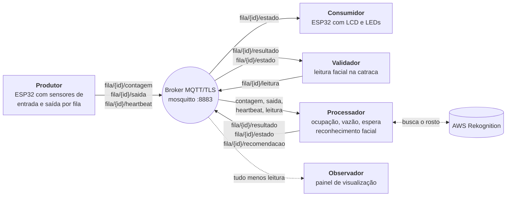

# Grupo Leite de Pedra: Caio Castro Miranda, João Pedro de Brito Tomé, João Victor Braga e Jaime da Cruz

# Marco 3 — balanceamento seguro de filas de entrada

O sistema conta quem entra e quem sai de cada fila de entrada de um evento,
estima o tempo de espera e sinaliza num semáforo (verde, amarelo, vermelho)
qual fila procurar, para que um pico de chegada se distribua em vez de
empilhar numa fila só. Na catraca, a pessoa é identificada pelo rosto: o
processador compara a leitura com a coleção do AWS Rekognition e devolve se
ela foi aceita.

## Estrutura do repositório

| Pasta | O que é |
|---|---|
| [`produtor/`](produtor/) | Firmware dos ESP32 simulados no Wokwi: o ESP32 das filas com um sensor na entrada e outro na saída de cada fila (`src/main.cpp`), o consumidor com LCD e LEDs (`src/consumidor.cpp`, circuito em `consumidor/`) e o intruso sem credencial (`intruso/`). Também traz `preparar-wokwi.py`, que grava as senhas no firmware. |
| [`validador/`](validador/) | Leitura facial na catraca: envia a leitura ao processador e mostra se a pessoa foi aceita. Hoje é uma página local (`index.html`) servida por `servidor.py` que simula a câmera; será substituída pela aplicação mobile. |
| [`broker/`](broker/) | Broker MQTT Mosquitto: configuração TLS, ACL por papel e scripts para gerar credenciais, iniciar o broker e testar a autorização. |
| [`processador/`](processador/) | Serviço que consome os movimentos dos sensores e as leituras faciais, calcula ocupação, vazão e espera, decide o reconhecimento facial e publica o estado de cada fila e o resultado de cada leitura. |
| [`observador/`](observador/) | Acompanha movimentos, resultados e estados (nunca as leituras faciais), mede latência e alerta queda de enlace. Hoje roda no terminal; será o painel web de visualização. |
| [`tests/`](tests/) | Testes automatizados (`python3 -m unittest discover -s tests`). |
| [`entregas/`](entregas/) | Entregas da disciplina; ver [Entregas](#entregas). |

Na raiz ficam os módulos Python compartilhados: `mqtt_config.py` (conexão
TLS autenticada usada por todos os clientes) e `estado_filas.py` (saldo das
filas em SQLite).

## Fluxo



1. O **produtor** detecta pelos HC-SR04 quem entra (`contagem`) e quem sai (`saida`) de cada fila e publica também o heartbeat.
2. O **validador** lê o rosto na catraca e publica a `leitura`, com a referência da foto.
3. O **processador** mantém o saldo em SQLite a partir dos sensores, mede a vazão pelas saídas e estima a espera. Para cada leitura, consulta o Rekognition e publica o `resultado`: `aceito`, `recusado` ou `indeterminado`.
4. O **validador** recebe o resultado e libera ou barra a pessoa; o **consumidor** acende LEDs e LCD indicando a fila com menor espera; o **observador** acompanha tudo, exceto as leituras faciais.

A ocupação depende só dos sensores: uma pessoa recusada ou que desiste
continua sendo contada até passar pelo sensor de saída. O reconhecimento
decide quem passa, não quantos estão na fila.

O Wokwi não executa dois microcontroladores no mesmo projeto. Por isso há
dois circuitos (`produtor/diagram.json` e `produtor/consumidor/diagram.json`),
abertos em duas instâncias da simulação. Eles se comunicam pelo broker local,
não por fios entre as placas.

| Componente | Publica | Assina |
|---|---|---|
| `produtor/src/main.cpp` (`produtor`) | `fila/{id}/contagem`, `fila/{id}/saida`, `fila/{id}/heartbeat` | — |
| `produtor/src/consumidor.cpp` (`consumidor`) | — | `fila/+/estado` |
| `validador/servidor.py` (`validador`) | `fila/{id}/leitura` | `fila/+/resultado`, `fila/+/estado` |
| `processador/processador.py` | `fila/{id}/resultado`, `fila/{id}/estado`, `fila/{id}/recomendacao` | `fila/+/contagem`, `fila/+/saida`, `fila/+/heartbeat`, `fila/+/leitura` |
| `observador/observador.py` | — | `contagem`, `saida`, `heartbeat`, `resultado`, `estado`, `recomendacao` |

Na demonstração Wokwi, `{id}` é `fila-a` ou `fila-b`.

## Payloads

Todos são JSON.

### Telemetria (produtor → processador e observador)

`eventTimeMs` é o instante em que o evento aconteceu (epoch em ms), obtido do
relógio do ESP32 sincronizado inicialmente por NTP. O ESP32
atribui `eventId` único a cada movimento; o validador também atribui um
`eventId` a cada leitura. O processador ignora eventos repetidos pelo MQTT.

**`fila/{id}/contagem`** — o sensor de entrada detectou uma pessoa entrando na fila.

```json
{"eventId": "esp32-abc-41", "filaId": "fila-a", "tipo": "contagem", "eventTimeMs": 1758200000000}
```

**`fila/{id}/saida`** — o sensor de saída detectou uma pessoa deixando a fila.
É o que reduz a ocupação e mede a vazão.

```json
{"eventId": "esp32-abc-42", "filaId": "fila-a", "tipo": "saida", "eventTimeMs": 1758200007000}
```

**`fila/{id}/heartbeat`** — a cada 2 s simulados, por fila. Não entra na
contagem; só prova que o enlace está vivo. O processador mede a atividade pelo
instante em que recebe o heartbeat em seu relógio monotônico, com tolerância
de 15 s reais. O `eventTimeMs` não determina essa atividade: no Wokwi, o
relógio simulado pode avançar mais devagar que o relógio do computador.

```json
{"filaId": "fila-a", "tipo": "heartbeat", "eventTimeMs": 1758200014000}
```

### Leitura facial (validador → processador)

**`fila/{id}/leitura`** — a câmera da catraca capturou um rosto. Só a
referência da foto passa pelo broker: a imagem fica num bucket e nenhum outro
assinante recebe biometria. Pela ACL, só o processador lê este tópico.

```json
{"eventId": "8e7d2184e4f0410895e2af6da4e5e2a1", "filaId": "fila-a", "tipo": "leitura", "fotoRef": "demo/rosto-cadastrado.jpg", "eventTimeMs": 1758200006000}
```

**`fila/{id}/resultado`** — a decisão do processador para aquela leitura,
com o mesmo `eventId`, para o validador saber a qual leitura ela responde.

```json
{"eventId": "8e7d2184e4f0410895e2af6da4e5e2a1", "filaId": "fila-a", "tipo": "resultado", "resultado": "aceito", "eventTimeMs": 1758200006900}
```

| `resultado` | Significado |
|---|---|
| `aceito` | o rosto corresponde a alguém com ingresso |
| `recusado` | nenhum rosto da coleção corresponde |
| `indeterminado` | o reconhecimento falhou; o operador decide manualmente |

Por enquanto o reconhecimento é simulado em `avaliar_rosto`, no processador:
aceita só `demo/rosto-cadastrado.jpg`. A troca pelo `SearchFacesByImage` do
Rekognition acontece só nessa função, quando a coleção e o bucket existirem.

### Recomendação e estado (processador → consumidor e observador)

**`fila/{id}/recomendacao`** — publicada só quando o par (`semaforo`, `sentidoRecomendado`) muda.

```json
{
  "filaId": "fila-a",
  "semaforo": "bloqueada",
  "ocupacao": 5,
  "sentidoRecomendado": "fila-b",
  "motivo": "fila-a está VERMELHO (34s de espera, 5 na fila); fila-b está VERDE (7s de espera, 1 na fila)",
  "tempoEsperaEstimado": 34
}
```

| Campo | Valores |
|---|---|
| `semaforo` | `livre` (verde, espera ≤ 15 s), `atencao` (amarelo, 15–30 s), `bloqueada` (vermelho, > 30 s) |
| `ocupacao` | entradas − saídas registradas pelos sensores |
| `sentidoRecomendado` | a própria fila (permanecer) ou a fila para onde desviar |
| `motivo` | texto explicando a decisão |
| `tempoEsperaEstimado` | segundos; `null` se a espera ficar indeterminada (por exemplo, ninguém saindo da fila) |

**`fila/{id}/estado`** contém `filaId`, `semaforo`, `ocupacao`,
`sentidoRecomendado` e `tempoEsperaEstimado`. É publicado com QoS 1 e `retain`
para que o consumidor recupere o estado ao reconectar. A ocupação é persistida em
`.local/filas.sqlite3`.
Antes de o sensor de saída registrar duas passagens, a espera usa 7 s por pessoa; depois passa a
usar a vazão observada. Assim o semáforo já reage ao crescimento da fila.

## Como rodar

### Segurança

Cada componente possui uma identidade MQTT diferente. O broker autentica essas
identidades por senha e aplica o princípio do menor privilégio por meio de ACLs:

| Identidade | Permissões |
|---|---|
| `produtor` | publica entradas, saídas e heartbeat |
| `consumidor` | somente lê o estado das filas |
| `processador` | lê movimentos e leituras faciais; publica resultados, estados e recomendações |
| `observador` | somente lê; não tem acesso às leituras faciais |
| `validador` | publica leituras faciais; lê resultados e o estado das filas |

O listener sem criptografia foi removido. Toda comunicação usa MQTT sobre TLS na
porta 8883, e os clientes validam o certificado do broker usando a CA local.
Senhas, chaves privadas e certificados de desenvolvimento ficam em
`.local/mqtt`, diretório ignorado pelo Git.

### Preparação

Instale as dependências uma vez:

```
sudo apt install mosquitto mosquitto-clients openssl python3-paho-mqtt
```

Gere a CA, o certificado de `localhost`/`host.wokwi.internal` e as cinco
credenciais aleatórias, depois prepare um cabeçalho local para cada ESP32:

```
./broker/configurar-seguranca.sh
python3 produtor/preparar-wokwi.py
```

O script se recusa a sobrescrever uma configuração existente. Os arquivos de
senha individuais são lidos diretamente pelos clientes e têm permissão `0600`.
Os clientes usam a API de callbacks da versão 2 do Paho MQTT.
Se você já tinha a configuração anterior, execute
`./broker/configurar-seguranca.sh --adicionar-consumidor` uma vez. Se ela
ainda não tinha o usuário `validador`, execute também
`./broker/configurar-seguranca.sh --adicionar-validador`. Depois rode
`python3 produtor/preparar-wokwi.py` e reinicie o broker. Não é necessário
renovar o certificado para adicionar apenas esse usuário.

### Execução

Para a demonstração integrada, use quatro terminais na raiz do projeto:

```
mkdir -p .local/logs
./broker/iniciar-broker.sh 2>&1 | tee .local/logs/broker.log                    # terminal 1
python3 -u processador/processador.py 2>&1 | tee .local/logs/processador.log        # terminal 2
python3 -u observador/observador.py 2>&1 | tee .local/logs/observador.log        # terminal 3
python3 -u validador/servidor.py 2>&1 | tee .local/logs/validador.log            # terminal 4
```

Abra `http://localhost:8000` no navegador. Abaixo das filas, a página mostra
as últimas linhas de cada terminal (lidas de `.local/logs/`) e a serial de
cada ESP32: o Wokwi expõe a serial dos sensores na porta 4000 e a do
consumidor na 4001 (`rfc2217ServerPort` nos `wokwi.toml`). Compile **ambos** os firmwares na
pasta `produtor/` com `pio run` (ou PlatformIO: Build). Em uma janela do VS Code,
selecione `produtor/wokwi.toml` em `F1 → Wokwi: Select Config File` e inicie o
simulador: essa janela contém apenas os sensores. Em outra janela/instância do
VS Code, selecione `produtor/consumidor/wokwi.toml` e inicie a segunda simulação,
com o LCD e os LEDs. A simulação em VS Code precisa do gateway local do Wokwi para alcançar o broker
em `host.wokwi.internal:8883` (consulte a disponibilidade dessa função na sua
licença). Cada firmware usa um cabeçalho local próprio, gerado em
`produtor/include/` e ignorado pelo Git, com apenas a senha do seu papel MQTT.

O circuito dos sensores tem quatro HC-SR04: na linha de cima, as entradas
das filas A e B; na de baixo, as saídas. No Wokwi, clique em um sensor para
alterar a distância. Faça o ciclo **400 cm → 40 cm → 400 cm** para
representar a passagem de uma pessoa; só a transição para perto conta. Repita
na entrada da fila A até haver três pessoas: com a estimativa inicial de 7 s
por pessoa, ela fica amarela. Cinco pessoas a deixam vermelha. Faça o mesmo
ciclo no sensor de saída da fila A e a ocupação cai uma unidade. O LCD e os
LEDs da segunda simulação seguem o estado enviado pelo processador.

Na página do validador, **Ler rosto cadastrado** e **Ler rosto
desconhecido** simulam a câmera. O resultado (`aceito` ou `recusado`) volta
do processador e aparece no cartão da fila, sem alterar a ocupação.

O SQLite em `.local/filas.sqlite3` preserva a ocupação ao reiniciar o
processador. Para iniciar outro evento real, arquive ou zere esse banco de forma
deliberada; o projeto não apaga pessoas da fila automaticamente.

Por padrão, o broker aceita apenas conexões da própria máquina. Para usar outro
host, configure `MQTT_HOST`, `MQTT_PORT`, `MQTT_CA`, `MQTT_USERNAME` e
`MQTT_PASSWORD` (ou `MQTT_PASSWORD_FILE`) no ambiente. Nesse caso, emita um
certificado que contenha o nome DNS/IP do servidor e altere o endereço do
`listener` em `broker/mosquitto.conf`; não desative a validação TLS.

### Verificação da autorização

Depois de iniciar o broker, um observador autenticado consegue assinar os
tópicos. Mesmo assinando `fila/#`, ele não recebe `fila/+/leitura`, porque a ACL
filtra cada mensagem:

```
mosquitto_sub -h localhost -p 8883 \
  --cafile .local/mqtt/ca.crt \
  -u observador -P "$(cat .local/mqtt/observador.password)" \
  -t 'fila/#' -v
```

Esse mesmo usuário não consegue publicar, e um cliente anônimo não consegue se
conectar. As negativas aparecem no log do broker. TLS protege os dados em
trânsito; o SQLite em `.local/` não é criptografado em repouso.

Para ver um **firmware sem a senha** tentando entrar, compile o ambiente
`intruso` (`pio run` já o inclui) e inicie a simulação de
`produtor/intruso/wokwi.toml`. Ele usa o mesmo circuito dos sensores e a CA
(que é pública), mas uma senha inventada para o usuário `produtor`. O serial
mostra `Falha MQTT: ... (retorno 5)` a cada 3 s, e o log do broker registra
`wokwi-intruso ... disconnected: not authorised`. Nenhuma contagem chega ao
processador.

Para testar também a restrição de leitura com o broker em execução:

```
python3 broker/testar-acl.py
```

Se precisar renovar apenas a CA e o certificado do broker, preserve as senhas com
`./broker/configurar-seguranca.sh --renovar-certificados` e reinicie o broker.

## Entregas

| Entrega | Conteúdo |
|---|---|
| [`entregas/Marco1/atividade-01.md`](entregas/Marco1/atividade-01.md) | Atividade em Grupo 01: análise inicial do sistema ubíquo e do cenário escolhido. |
| [`entregas/Marco2/atividade-02.md`](entregas/Marco2/atividade-02.md) | Atividade em Grupo 02: eventos do sistema e distribuição de responsabilidades. |
| [`entregas/Marco1/`](entregas/Marco1/) | Protótipos individuais no Wokwi, um por integrante, com relatório e evidências dos testes. |
| [`entregas/Marco2/`](entregas/Marco2/) | Primeira integração produtor → MQTT → processador, com README e roteiro de demonstração próprios. |
| [`entregas/Marco3/`](entregas/Marco3/) | Apresentação de segurança (TLS, autenticação e ACL), servida em `http://localhost:8000/apresentacao` pelo validador. O código do Marco 3 é o próprio repositório. |
