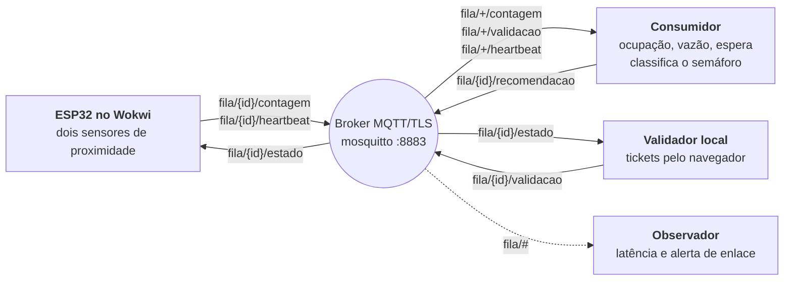

# Grupo Leite de Pedra: Caio Castro Miranda, João Pedro de Brito Tomé, João Victor Braga e Jaime da Cruz

# Marco 3 — balanceamento seguro de filas de entrada

O sistema conta quem entra e quem sai de cada fila de entrada de um evento,
estima o tempo de espera e sinaliza num semáforo (verde, amarelo, vermelho)
qual fila procurar, para que um pico de chegada se distribua em vez de
empilhar numa fila só.

## Fluxo



1. O **ESP32 simulado** detecta chegadas pelos HC-SR04 e publica contagem e heartbeat.
2. A **página local** simula a validação do ticket e publica a saída aprovada.
3. O **consumidor** mantém o saldo em SQLite, mede a vazão e publica o estado da fila.
4. O **ESP32** recebe o estado e acende LEDs e LCD; o **observador** acompanha todos os eventos.

| Componente | Publica | Assina |
|---|---|---|
| `wokwi/src/main.cpp` (`produtor`) | `fila/{id}/contagem`, `fila/{id}/heartbeat` | `fila/+/estado` |
| `validacao/servidor.py` (`validador`) | `fila/{id}/validacao` | `fila/+/estado` |
| `consumidor/consumidor.py` | `fila/{id}/recomendacao`, `fila/{id}/estado` | `fila/+/contagem`, `fila/+/validacao`, `fila/+/heartbeat` |
| `observador/observador.py` | — | `fila/#` |

Na demonstração Wokwi, `{id}` é `fila-a` ou `fila-b`. O antigo
`produtor/produtor.py` permanece como simulador alternativo sem Wokwi.

## Payloads

Todos são JSON.

### Telemetria (produtor → consumidor e observador)

`eventTimeMs` é o instante em que o evento aconteceu (epoch em ms). O ESP32
atribui `eventId` único às chegadas; o validador também atribui um `eventId`
à validação. O consumidor ignora eventos repetidos pelo MQTT.

**`fila/{id}/contagem`** — o sensor ultrassônico detectou uma pessoa entrando na fila.

```json
{"eventId": "esp32-abc-41", "filaId": "fila-a", "tipo": "contagem", "eventTimeMs": 1758200000000}
```

**`fila/{id}/validacao`** — o operador validou um ticket na página local.
Somente `aprovado` tira alguém da fila; o endpoint desta demonstração publica
apenas aprovações.

```json
{"eventId": "id-unico", "filaId": "fila-a", "tipo": "validacao", "eventTimeMs": 1758200007000, "resultado": "aprovado"}
```

```json
{"eventId": "outro-id", "filaId": "fila-a", "tipo": "validacao", "eventTimeMs": 1758200013000, "resultado": "reprovado"}
```

**`fila/{id}/heartbeat`** — a cada 2 s, por fila. Não entra na contagem; só prova que o enlace está vivo.

```json
{"filaId": "fila-a", "tipo": "heartbeat", "eventTimeMs": 1758200014000}
```

### Recomendação (consumidor → produtor e observador)

**`fila/{id}/recomendacao`** — publicada só quando o par (`semaforo`, `sentidoRecomendado`) muda.

```json
{
  "filaId": "fila-a",
  "semaforo": "bloqueada",
  "ocupacao": 5,
  "sentidoRecomendado": "fila-b",
  "motivo": "fila-a está VERMELHO (34s de espera, 5 na fila); fila-b está VERDE (7s de espera, 1 na fila)",
  "tempoEsperaEstimado": 34
}
```

| Campo | Valores |
|---|---|
| `semaforo` | `livre` (verde, espera ≤ 15 s), `atencao` (amarelo, 15–30 s), `bloqueada` (vermelho, > 30 s) |
| `ocupacao` | entradas contadas − saídas aprovadas |
| `sentidoRecomendado` | a própria fila (permanecer) ou a fila para onde desviar |
| `motivo` | texto explicando a decisão |
| `tempoEsperaEstimado` | segundos; `null` se a espera ficar indeterminada (por exemplo, validador parado) |

**`fila/{id}/estado`** contém `filaId`, `semaforo`, `ocupacao`,
`sentidoRecomendado` e `tempoEsperaEstimado`. É publicado com QoS 1 e `retain`
para que o ESP32 recupere o estado ao reconectar. A ocupação é persistida em
`.local/filas.sqlite3`; o arquivo `eventos.json` é apenas um espelho temporário.
Antes de haver duas validações, a espera usa 7 s por pessoa; depois passa a
usar a vazão observada. Assim o semáforo já reage ao crescimento da fila.

## Como rodar

### Segurança

Cada componente possui uma identidade MQTT diferente. O broker autentica essas
identidades por senha e aplica o princípio do menor privilégio por meio de ACLs:

| Identidade | Permissões |
|---|---|
| `produtor` | publica chegadas/heartbeat e lê o estado das filas |
| `consumidor` | lê telemetria e publica recomendações |
| `observador` | somente lê `fila/#` |
| `validador` | publica validações e lê o estado das filas |

O listener sem criptografia foi removido. Toda comunicação usa MQTT sobre TLS na
porta 8883, e os clientes validam o certificado do broker usando a CA local.
Senhas, chaves privadas e certificados de desenvolvimento ficam em
`.local/mqtt`, diretório ignorado pelo Git.

### Preparação

Instale as dependências uma vez:

```
sudo apt install mosquitto mosquitto-clients openssl python3-paho-mqtt
```

Gere a CA, o certificado de `localhost`/`host.wokwi.internal` e as quatro
credenciais aleatórias, depois prepare o cabeçalho local do ESP32:

```
./scripts/configurar-seguranca.sh
python3 scripts/preparar-wokwi.py
```

O script se recusa a sobrescrever uma configuração existente. Os arquivos de
senha individuais são lidos diretamente pelos clientes e têm permissão `0600`.
Os clientes usam a API de callbacks da versão 2 do Paho MQTT.
Se você já tinha a configuração antiga de três usuários, execute uma vez
`./scripts/configurar-seguranca.sh --adicionar-validador`, depois
`./scripts/configurar-seguranca.sh --renovar-certificados` e por fim
`python3 scripts/preparar-wokwi.py`. Reinicie o broker.

### Execução

Para a demonstração integrada, use quatro terminais na raiz do projeto:

```
./scripts/iniciar-broker.sh                 # terminal 1
python3 -u consumidor/consumidor.py        # terminal 2
python3 -u observador/observador.py        # terminal 3
python3 -u validacao/servidor.py            # terminal 4
```

Abra `http://localhost:8000` no navegador. No VS Code, abra a pasta `wokwi/`,
compile o firmware com PlatformIO e use `F1 → Wokwi: Start Simulator`. A
simulação em VS Code precisa do gateway local do Wokwi para alcançar o broker
em `host.wokwi.internal:8883` (consulte a disponibilidade dessa função na sua
licença). O cabeçalho `wokwi/include/segredos.h` é gerado localmente e ignorado
pelo Git.

No Wokwi, clique em cada HC-SR04 para alterar a distância. Faça o ciclo
**400 cm → 40 cm → 400 cm** para representar a passagem de uma pessoa pela
entrada; só a transição para perto conta. Repita na fila A até haver três
pessoas: com a estimativa inicial de 7 s por pessoa, ela fica amarela. Cinco
pessoas a deixam vermelha. Na página, valide um ticket da fila A para registrar
uma saída; a contagem cai uma unidade. O LCD e os LEDs seguem o estado enviado
pelo consumidor. **Não execute `produtor/produtor.py` junto com o Wokwi**:
ele é um simulador alternativo e geraria eventos adicionais.

O SQLite em `.local/filas.sqlite3` preserva a ocupação ao reiniciar o
consumidor. Para iniciar outro evento real, arquive ou zere esse banco de forma
deliberada; o projeto não apaga pessoas da fila automaticamente.

Por padrão, o broker aceita apenas conexões da própria máquina. Para usar outro
host, configure `MQTT_HOST`, `MQTT_PORT`, `MQTT_CA`, `MQTT_USERNAME` e
`MQTT_PASSWORD` (ou `MQTT_PASSWORD_FILE`) no ambiente. Nesse caso, emita um
certificado que contenha o nome DNS/IP do servidor e altere o endereço do
`listener` em `mosquitto.conf`; não desative a validação TLS.

### Verificação da autorização

Depois de iniciar o broker, um observador autenticado consegue assinar os
tópicos:

```
mosquitto_sub -h localhost -p 8883 \
  --cafile .local/mqtt/ca.crt \
  -u observador -P "$(cat .local/mqtt/observador.password)" \
  -t 'fila/#' -v
```

Esse mesmo usuário não consegue publicar, e um cliente anônimo não consegue se
conectar. As negativas aparecem no log do broker. TLS protege os dados em
trânsito; os arquivos `eventos.json` não são criptografados em repouso.

Para testar também a restrição de leitura com o broker em execução:

```
python3 scripts/testar-acl.py
```

Se precisar renovar apenas a CA e o certificado do broker, preserve as senhas com
`./scripts/configurar-seguranca.sh --renovar-certificados` e reinicie o broker.
