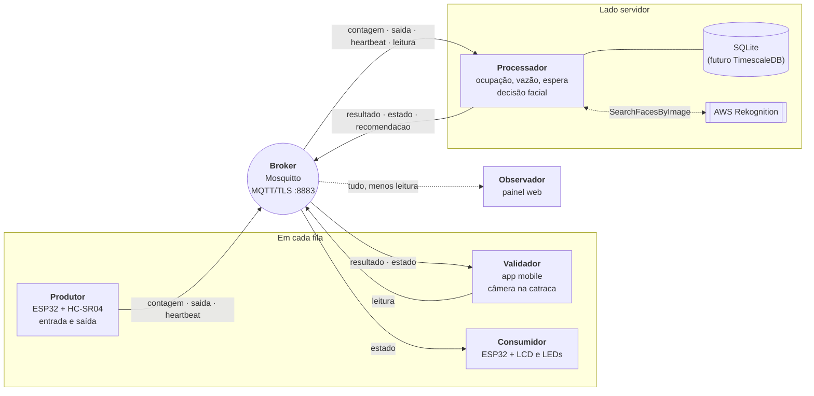
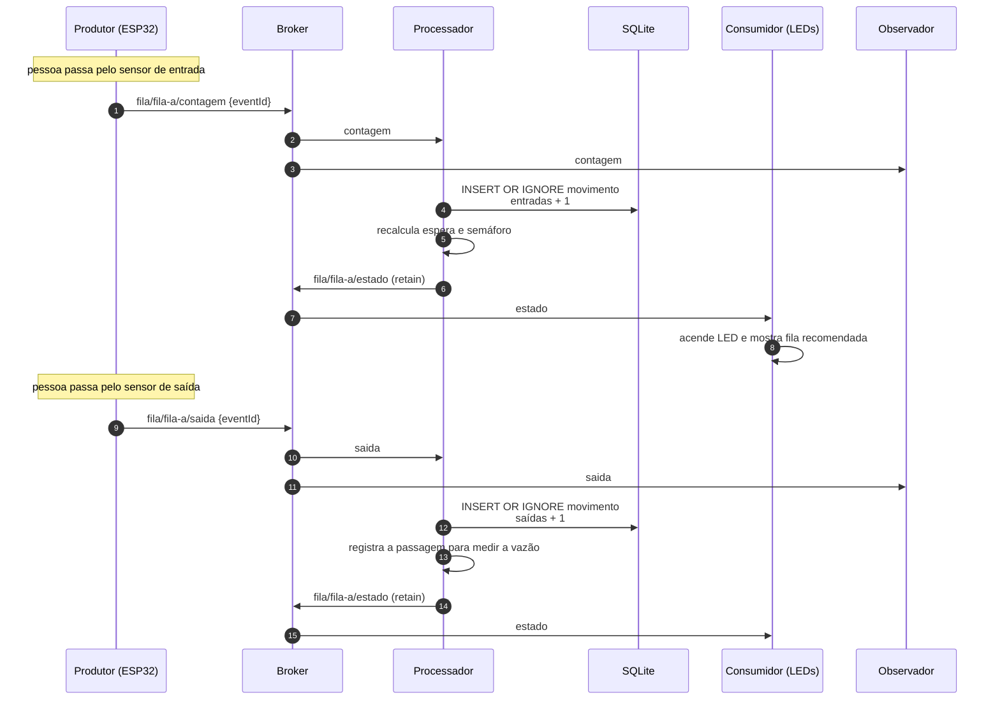
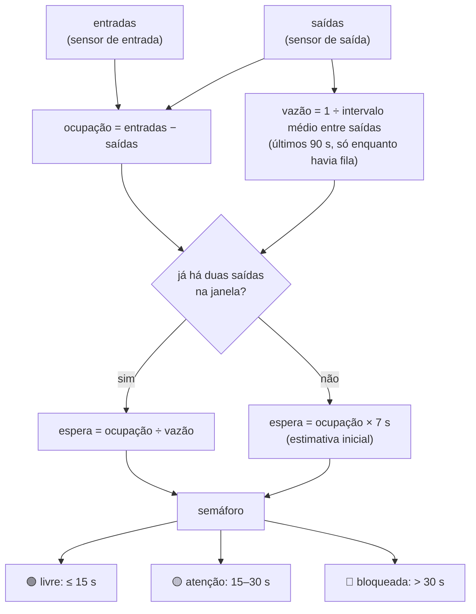
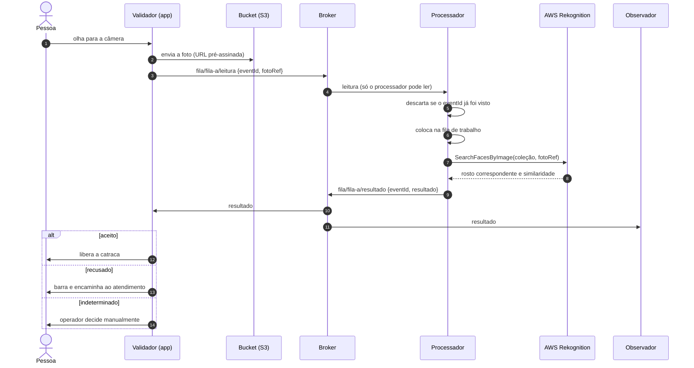
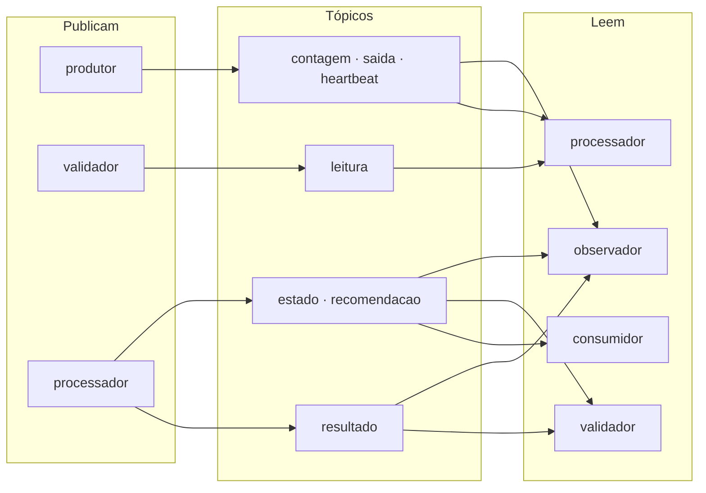
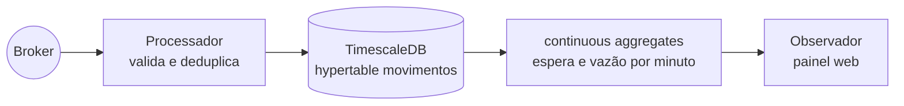

# Arquitetura — balanceamento de filas com reconhecimento facial

Este documento descreve o fluxo completo do sistema: quem publica o quê, quem
decide, como a espera é estimada e como a pessoa é liberada na catraca. Os
detalhes de execução ficam no [README](../README.md).

## Visão geral

O evento tem várias filas de entrada. Em cada fila, **sensores** contam quem
entra e quem sai, e uma **câmera** na catraca identifica a pessoa pelo rosto.
Um **processador** central junta esses dados para:

1. estimar o tempo de espera de cada fila e indicar ao público a fila com
   menor espera;
2. decidir, via AWS Rekognition, se a pessoa diante da câmera pode passar.

Toda a comunicação passa por um broker MQTT (Mosquitto) com TLS, autenticação
por senha e ACL por componente.

> **Todo componente, atual ou futuro, segue as mesmas regras de segurança.**
> Isso inclui o app mobile, o painel web, o TimescaleDB e a integração com
> AWS Rekognition e S3. Nenhum componente entra no sistema sem cumprir as
> [regras obrigatórias](#regras-obrigatórias-de-segurança) descritas abaixo.

## Componentes

| Componente | Onde está | Papel |
|---|---|---|
| **Produtor** | `produtor/src/main.cpp` (ESP32 no Wokwi) | Sensores HC-SR04 na entrada e na saída de cada fila. Publica cada movimento e um heartbeat. |
| **Validador** | `validador/` (hoje página local; futuro app mobile) | Lê o rosto na catraca, envia a leitura e mostra se a pessoa foi aceita. |
| **Broker** | `broker/` (Mosquitto) | Entrega as mensagens entre os componentes, com TLS e ACL. |
| **Processador** | `processador/processador.py` | Único que decide: calcula ocupação, vazão e espera e avalia cada leitura facial. |
| **Consumidor** | `produtor/src/consumidor.cpp` (ESP32 no Wokwi) | LCD e LEDs que indicam ao público qual fila procurar. |
| **Observador** | `observador/` (hoje terminal; futuro painel web) | Visualiza movimentos, resultados e estados. Nunca recebe biometria. |
| **AWS Rekognition** | serviço externo | Compara o rosto lido com a coleção de rostos cadastrados. |

## Tópicos MQTT

O MQTT não tem filas, tem **tópicos**: o broker entrega cada mensagem a quem
assina o tópico, sem guardá-la em fila. Todos os tópicos seguem
`fila/{id}/{tipo}`, com `{id}` igual a `fila-a`, `fila-b` etc.

| Tópico | Publica | Assina | Conteúdo |
|---|---|---|---|
| `fila/{id}/contagem` | produtor | processador, observador | uma pessoa entrou na fila |
| `fila/{id}/saida` | produtor | processador, observador | uma pessoa saiu da fila |
| `fila/{id}/heartbeat` | produtor | processador, observador | o enlace do ESP32 está vivo (a cada 2 s) |
| `fila/{id}/leitura` | validador | **só** processador | referência da foto capturada na catraca |
| `fila/{id}/resultado` | processador | validador, observador | `aceito`, `recusado` ou `indeterminado` |
| `fila/{id}/estado` | processador | consumidor, validador, observador | semáforo, ocupação, espera e fila recomendada (retido) |
| `fila/{id}/recomendacao` | processador | observador | mudança de recomendação, com o motivo |

## Fluxo 1 — contagem de pessoas e estimativa de espera

A ocupação vem **só dos sensores**: entradas − saídas. O reconhecimento
facial não altera a contagem. Assim, quem é recusado ou desiste continua
contado até passar pelo sensor de saída, e a espera reflete o movimento real.

### Como a espera é calculada

- **Histerese:** para voltar a um nível melhor, a espera precisa cair 7 s
  abaixo do limite. Isso evita que o semáforo fique piscando entre duas cores.
- **Recomendação:** uma fila amarela ou vermelha indica a fila em estado
  melhor e com menor espera. É o que o consumidor mostra ao público.
- **Heartbeat:** se o processador fica 15 s sem receber heartbeat de uma fila,
  ele para de recomendá-la, porque não tem dados confiáveis.

## Fluxo 2 — reconhecimento facial na catraca

Decisões deste fluxo:

- **A foto não passa pelo broker.** Biometria é dado pessoal sensível (LGPD).
  A leitura leva só a referência (`fotoRef`) da imagem no bucket, e a ACL
  impede que qualquer outro componente leia `fila/+/leitura`.
- **Quem decide é o processador.** As credenciais da AWS ficam só no servidor,
  nunca no celular, e o validador não consegue publicar um `resultado`.
- **O `eventId` liga a resposta à pergunta.** O `resultado` repete o
  `eventId` da `leitura`, então cada aparelho reconhece a resposta à sua
  leitura mesmo com vários validadores na mesma fila.
- **O reconhecimento roda fora da thread do MQTT.** O Rekognition leva perto
  de 1 s; uma thread de trabalho evita que contagens e saídas fiquem paradas
  esperando.
- **Falha não trava a fila.** Se o Rekognition não responder, o resultado é
  `indeterminado` e o operador decide.

### Situação atual da implementação

Cada próximo passo da tabela abaixo só é concluído quando cumpre as
[regras obrigatórias de segurança](#regras-obrigatórias-de-segurança).

| Parte | Hoje | Próximo passo |
|---|---|---|
| Reconhecimento | `avaliar_rosto` no processador simula o Rekognition: aceita só `demo/rosto-cadastrado.jpg` | trocar pela chamada `SearchFacesByImage` com a coleção real |
| Foto | o validador envia uma referência fixa de demonstração | o app envia a foto ao S3 e publica a chave |
| Cadastro de rostos | não existe | `IndexFaces` de cada portador de ingresso (por exemplo, na compra) |
| Validador | página local `validador/index.html` | app mobile com credencial MQTT própria (MQTT sobre WebSockets, se for híbrido) |
| Observador | terminal | painel web lendo o histórico do banco |
| Persistência | SQLite em `.local/filas.sqlite3` | TimescaleDB (ver abaixo) |

## Segurança e permissões

### Regras obrigatórias de segurança

Estas regras já valem para o produtor, o consumidor, o validador, o
processador e o observador. **Todo componente novo, e toda nova versão dos
atuais, precisa cumpri-las antes de entrar no sistema.** Nenhuma delas pode ser
desligada para facilitar um teste ou uma demonstração.

| # | Regra | Como já é aplicada hoje |
|---|---|---|
| 1 | **Só TLS.** Toda conexão é cifrada e valida o certificado do servidor pela CA do projeto. Nada de conexão sem criptografia nem de validação de certificado desligada. | O broker só escuta MQTT/TLS na porta 8883; `mqtt_config.py` exige a CA e TLS 1.2 ou superior; os ESP32 usam `WiFiClientSecure` com a CA. |
| 2 | **Uma identidade por componente.** Cada componente tem usuário e senha próprios; acesso anônimo é proibido. | `allow_anonymous false`; senhas geradas por `broker/configurar-seguranca.sh` e guardadas com hash no `mosquitto.passwd`. |
| 3 | **Menor privilégio.** Cada identidade só publica e só lê os tópicos de que precisa. Um papel novo começa sem permissão e ganha só o necessário. | `broker/mosquitto.acl`, testado por `broker/testar-acl.py`. |
| 4 | **Segredo fora do Git.** Senhas, chaves, certificados e credenciais de nuvem nunca são versionados. | `.local/` e `produtor/include/segredos*.h` estão no `.gitignore`; cada firmware recebe só a senha do seu papel. |
| 5 | **Desconfiar do que chega.** Todo dado recebido é validado: tópico e `filaId` coincidem, o tipo é conhecido, o tamanho é limitado e payload malformado é descartado sem derrubar o serviço. | Validações no processador, no observador e no servidor do validador (POST limitado a 1 KB). |
| 6 | **Idempotência.** Todo evento tem `eventId`, e repetições são ignoradas. | `INSERT OR IGNORE` em `estado_filas.py`. |
| 7 | **Uma única autoridade.** Só o processador publica estado, recomendação e resultado; quem envia dados não decide sobre eles. | ACL: só o `processador` escreve em `estado`, `recomendacao` e `resultado`. |
| 8 | **Biometria mínima.** A foto nunca passa pelo broker nem é gravada fora do bucket; só a referência circula, e só o processador a lê. | ACL: só o `processador` lê `fila/+/leitura`; o observador não recebe leituras. |

### Como as regras se aplicam aos próximos componentes

| Componente | O que ele precisa ter |
|---|---|
| **App mobile (validador)** | Usuário MQTT `validador` com senha própria por aparelho ou por operador; TLS validando a CA (inclusive em MQTT sobre WebSockets, que precisa de `listener` com TLS no Mosquitto); nenhuma credencial AWS no aparelho, só URLs pré-assinadas de upload e de curta duração; nenhuma foto guardada no celular depois do envio. |
| **Painel web (observador)** | Usuário `observador`, somente leitura e sem acesso a `fila/+/leitura`; login para quem acessa o painel; HTTPS; credenciais MQTT e do banco só no servidor, nunca no navegador. |
| **TimescaleDB** | Conexão com TLS obrigatório (`sslmode=verify-full`); um usuário de escrita só para o processador e um usuário somente leitura para o painel; senha fora do Git; banco sem porta exposta à internet. |
| **AWS Rekognition e S3** | Credenciais só no processador, com uma política IAM que permita apenas `SearchFacesByImage` na coleção do evento e leitura e exclusão no bucket das fotos; bucket privado e cifrado; fotos apagadas logo após a avaliação; nenhuma chave da AWS no Git nem no app. |

### Permissões no broker

Cada componente tem usuário e senha próprios, e a ACL do broker
(`broker/mosquitto.acl`) aplica o menor privilégio:

| Identidade | Pode publicar | Pode ler | Não pode |
|---|---|---|---|
| `produtor` | contagem, saída, heartbeat | nada | ler dados, emitir estado |
| `validador` | leitura | resultado, estado | criar entradas ou saídas, decidir o próprio resultado |
| `processador` | resultado, estado, recomendação | contagem, saída, heartbeat, leitura | — |
| `consumidor` | nada | estado | criar movimentos |
| `observador` | nada | tudo, menos leitura | escrever, ver biometria |

## Persistência futura com TimescaleDB

O TimescaleDB entra **no processador**, no lugar do SQLite de
`estado_filas.py`. Ele é o único componente que já deduplica e valida os
eventos; um serviço separado que assinasse os tópicos gravaria mensagens
repetidas ou forjadas.

- `movimentos` vira uma hypertable particionada por `eventTimeMs`, com
  contagens, saídas e resultados das leituras.
- A ocupação passa a ser uma consulta (entradas − saídas por fila).
- O painel web lê o histórico e os agregados direto do banco; o MQTT continua
  servindo o tempo real.
- A conexão com o banco segue as [regras obrigatórias](#regras-obrigatórias-de-segurança):
  TLS com verificação do certificado, um usuário de escrita só para o processador,
  um usuário somente leitura para o painel e senhas fora do Git.
