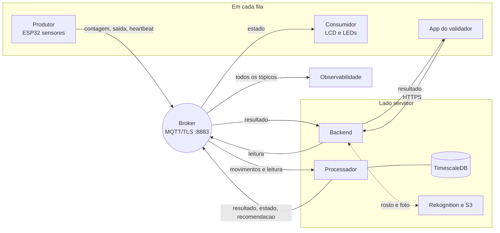
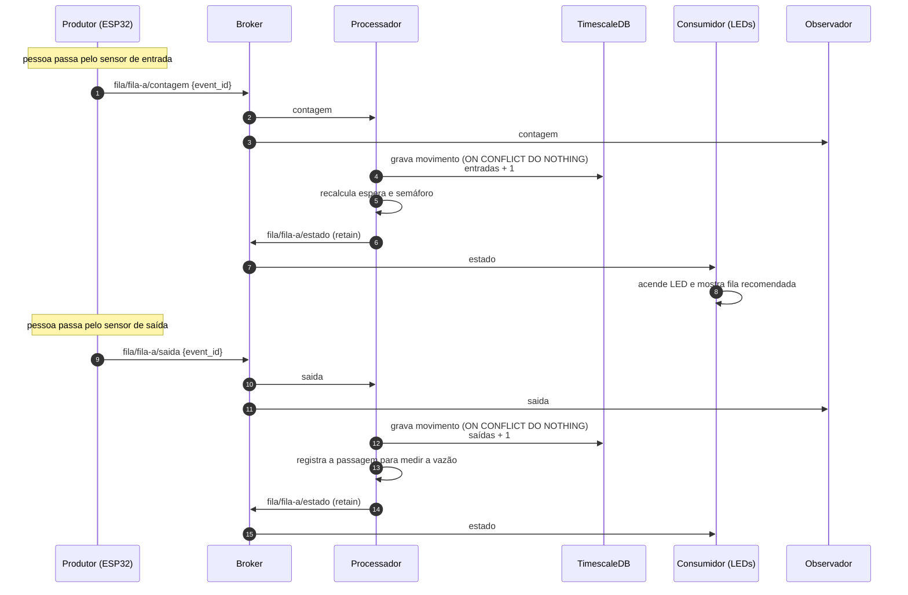
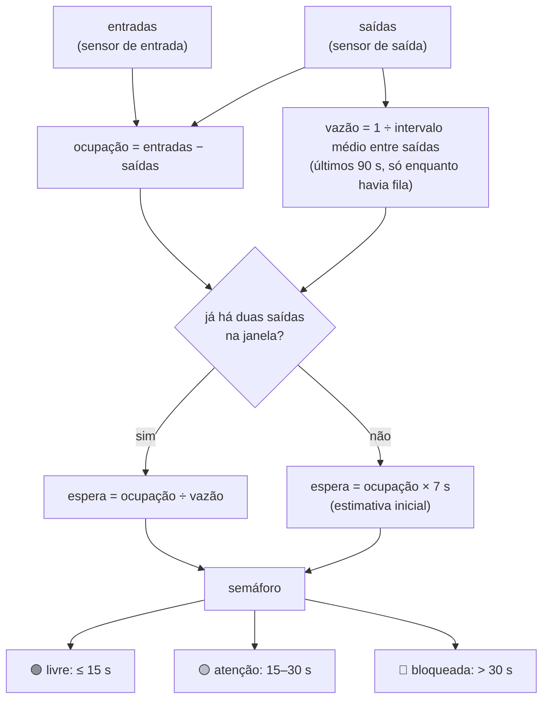
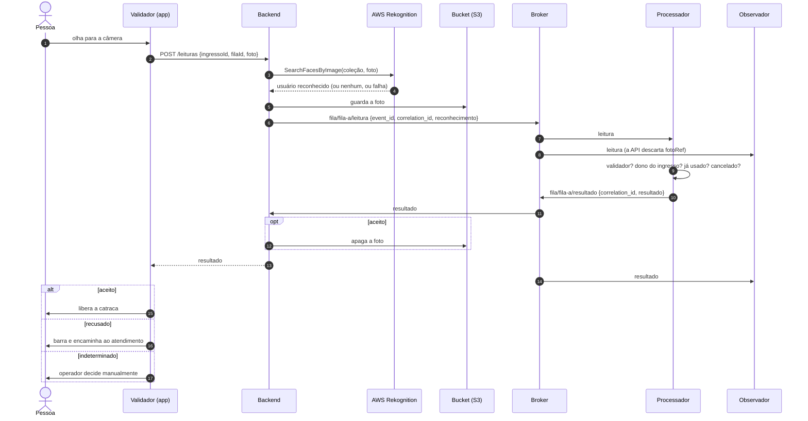
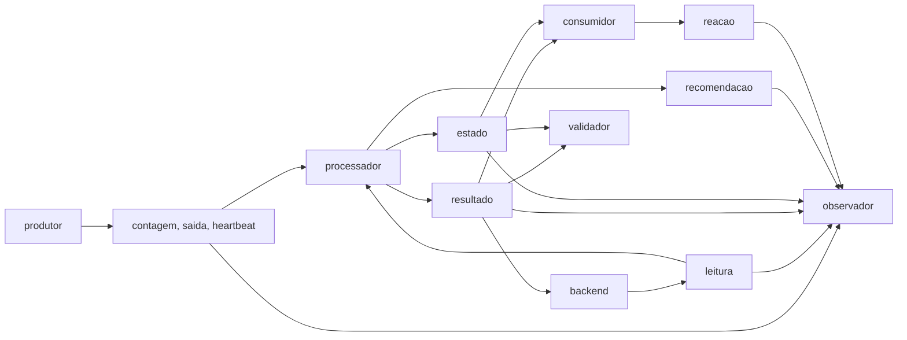
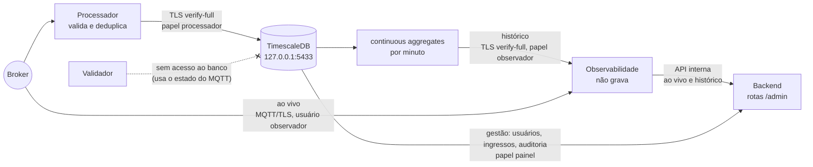
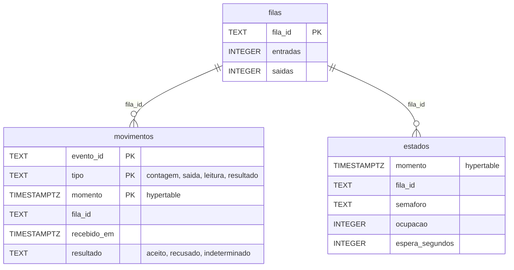
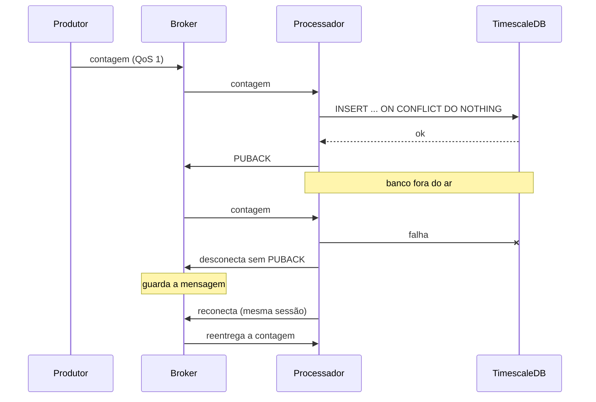

# Arquitetura — balanceamento de filas com reconhecimento facial

Este documento descreve o fluxo completo do sistema: quem publica o quê, quem
decide, como a espera é estimada e como a pessoa é liberada na catraca. Os
quatro caminhos de uso estão em [caminhos.md](caminhos.md). Os detalhes de
execução ficam no [README](../README.md).

## Visão geral

O evento tem várias filas de entrada. Em cada fila, **sensores** contam quem
entra e quem sai, e uma **câmera** na catraca identifica a pessoa pelo rosto.
Um **processador** central junta esses dados para:

1. estimar o tempo de espera de cada fila e indicar ao público a fila com
   menor espera;
2. decidir se o ingresso vale. Quem chama o Rekognition é o backend; o
   processador só aplica a regra do ingresso.

Toda a comunicação passa por um broker MQTT (Mosquitto) com TLS, autenticação
por senha e ACL por componente.

> **Todo componente, atual ou futuro, segue as mesmas regras de segurança.**
> Isso inclui o app mobile, o painel web, o banco TimescaleDB e a integração com
> AWS Rekognition e S3. Nenhum componente entra no sistema sem cumprir as
> [regras obrigatórias](#regras-obrigatórias-de-segurança) descritas abaixo.

## Componentes

| Componente | Onde está | Papel |
|---|---|---|
| **Produtor** | `produtor/src/main.cpp` (ESP32 no Wokwi) | Sensores HC-SR04 na entrada e na saída de cada fila. Publica cada movimento e um heartbeat. |
| **App do validador** | `mobile/` | Catraca: lê o QR e o rosto e fala só com o backend, por HTTPS. Não tem usuário MQTT. |
| **Console da demo** | `validador/` | Página local. Mostra estado e último resultado. Não publica leitura. |
| **Broker** | `broker/` (Mosquitto) | Entrega as mensagens entre os componentes, com TLS e ACL. |
| **Processador** | `processador/processador.py` | Único que decide: calcula ocupação, vazão e espera e avalia cada leitura facial. |
| **Consumidor** | `produtor/src/consumidor.cpp` (ESP32 no Wokwi) | LCD e LEDs que indicam ao público qual fila procurar. |
| **Observabilidade** | `observabilidade/` | Assina tudo no broker (usuário `observador`) e monta a situação ao vivo: filas, tentativas de leitura sem a referência da foto, resultados, reações, presença dos componentes e rejeitadas. Lê o histórico do banco com o papel `observador`, só de leitura. Não grava nada e não autentica ninguém: serve a API interna (`/ao-vivo`, `/resumo`, `/historico`, `/leituras`, `/movimentos`, `/estados`) só na rede interna. |
| **Dashboard de admin** | `admin/` (SPA React) + `backend/admin.py` | Mostra o ao vivo e o histórico operacional (lidos da observabilidade, com a permissão de admin conferida pelo backend) e, pela gestão no banco (papel `painel`), troca papéis e cancela ingressos, com auditoria. A foto de uma leitura só abre por link temporário, e cada abertura fica registrada. |
| **AWS Rekognition** | serviço externo | Compara o rosto lido com a coleção de rostos cadastrados. |



## Tópicos MQTT

O MQTT não tem filas, tem **tópicos**: o broker entrega cada mensagem a quem
assina o tópico, sem guardá-la em fila. Os tópicos das filas seguem
`fila/{id}/{tipo}`, com `{id}` igual a `fila-a`, `fila-b` etc.; a presença de
cada componente fica em `sistema/{usuario}/status`.

| Tópico | Publica | Assina | Conteúdo |
|---|---|---|---|
| `fila/{id}/contagem` | produtor | processador, observabilidade | uma pessoa entrou na fila |
| `fila/{id}/saida` | produtor | processador, observabilidade | uma pessoa saiu da fila |
| `fila/{id}/heartbeat` | produtor | processador, observabilidade | o enlace do ESP32 está vivo (a cada 2 s) |
| `fila/{id}/leitura` | backend | processador, observabilidade | referência da foto. A API da observabilidade descarta `fotoRef` |
| `fila/{id}/resultado` | processador | backend, consumidor, validador, observabilidade | `aceito`, `recusado` ou `indeterminado` |
| `fila/{id}/estado` | processador | consumidor, validador, observabilidade | semáforo, ocupação, espera e fila recomendada (retido) |
| `fila/{id}/recomendacao` | processador | observabilidade | mudança de recomendação, com o motivo |
| `fila/{id}/reacao` | consumidor | observabilidade | a reação que o ESP32 executou para um `resultado` (`liberar`, `decidir-manual` ou `barrar`), com o `correlation_id` da leitura |
| `sistema/{usuario}/status` | cada componente (o próprio) | observabilidade | `online` ao conectar; `offline` pelo Last Will ou ao sair (retido) |
| `sistema/processador/rejeitado` | processador | observabilidade | mensagem descartada e o motivo: `fora-do-contrato`, `tipo-desconhecido`, `leitura-incompleta` ou `duplicado` |

### Contrato das mensagens

Toda mensagem, em todos os tópicos, é um JSON com este envelope
(`mqtt_config.evento` monta, `mqtt_config.ler_evento` valida):

```json
{
  "event_id": "3f9a1c-42",
  "correlation_id": "3f9a1c-42",
  "event_type": "contagem",
  "source": "produtor",
  "timestamp": 1730851200000,
  "payload": { "filaId": "fila-a", "sequence": 42 }
}
```

| Campo | Regra |
|---|---|
| `event_id` | único por evento, até 128 caracteres. Em `movimentos`, a reentrega só é ignorada se `event_id`, `tipo` e `timestamp` forem os mesmos. A decisão de uma leitura repetida é achada pelo `event_id` da leitura. Na mensagem MQTT, o resultado usa `{event_id da leitura}-resultado`. |
| `correlation_id` | a operação de ponta a ponta. Quem abre a operação (o ESP32 num movimento, o backend numa leitura) gera um; todo evento derivado repete o dele. Gravado em `movimentos.correlacao_id`. |
| `event_type` | igual ao último nível do tópico. |
| `source` | o usuário MQTT de quem publicou (o broker usa o usuário como client id). Gravado em `movimentos.origem`. |
| `timestamp` | milissegundos desde 1970 (UTC), no momento em que o evento ocorreu na origem. No Last Will é o da conexão que o registrou. |
| `payload` | objeto com os dados do tipo. Em `fila/{id}/…`, `payload.filaId` é igual a `{id}`; em `sistema/{usuario}/…`, `source` é igual a `{usuario}`. |

Mensagem fora do contrato, ou que não combina com o tópico, é descartada (e
confirmada ao broker, para não voltar).

## Fluxo 1 — contagem de pessoas e estimativa de espera

A ocupação vem **só dos sensores**: entradas − saídas. O reconhecimento
facial não altera a contagem. Assim, quem é recusado ou desiste continua
contado até passar pelo sensor de saída, e a espera reflete o movimento real.



### Como a espera é calculada



- **Histerese:** para voltar a um nível melhor, a espera precisa cair 7 s
  abaixo do limite. Isso evita que o semáforo fique piscando entre duas cores.
- **Recomendação:** uma fila amarela ou vermelha indica a fila em estado
  melhor e com menor espera. É o que o consumidor mostra ao público.
- **Heartbeat:** o processador mede 15 s no relógio em que recebe a mensagem.
  Passou disso, deixa de usar a fila como destino e não publica estado novo.
  O último `estado` retido continua no LCD. O painel marca o enlace inativo aos 8 s.

## Fluxo 2 — reconhecimento facial na catraca



Decisões deste fluxo:

- **A foto não passa pelo broker.** A leitura leva só `fotoRef`. Quem publica é o backend. Quem lê é o processador e o observador. A API da observabilidade descarta `fotoRef`; um `mosquitto_sub` com o usuário `observador` mostra a referência.
- **O backend reconhece, o processador decide.** As credenciais da AWS ficam
  só no backend, nunca no celular nem no processador. O processador confia no
  `usuarioReconhecido` da leitura porque, pela ACL, só o backend publica em
  `fila/+/leitura`; e só ele publica `resultado`.
- **O `correlation_id` liga a resposta à pergunta.** O `resultado` repete o
  `correlation_id` da `leitura`, então o backend entrega cada resposta à
  catraca certa mesmo com vários validadores na mesma fila. A espera HTTP é de
  10 s. Se estourar, a rota responde 504 e esquece o `correlation_id`. A leitura
  já publicada continua na sessão do processador e ainda pode marcar o ingresso.
- **Sem AWS no caminho do MQTT.** O Rekognition leva perto de 1 s e roda na
  requisição HTTP do backend; o processador decide a leitura só com o banco,
  na própria thread do MQTT, sem segurar contagens e saídas.
- **Falha não trava a fila.** Se o Rekognition não responder, o resultado é
  `indeterminado` e o operador decide. O ingresso não é marcado.

### Situação atual da implementação

Cada próximo passo da tabela abaixo só é concluído quando cumpre as
[regras obrigatórias de segurança](#regras-obrigatórias-de-segurança).

| Parte | Hoje | Próximo passo |
|---|---|---|
| Reconhecimento | o backend chama `SearchFacesByImage` (95%) e publica o usuário reconhecido; o processador confere o papel do validador no banco e se o rosto é do dono do ingresso, e marca o ingresso na mesma transação do resultado | — |
| Foto | o backend guarda a foto em `leituras/` no S3 e a apaga assim que a leitura é **aceita**. Recusadas e indeterminadas ficam para o admin revisar até a regra do bucket apagá-las (1 dia), assim como a de uma leitura cujo resultado não chegou em 10 s | — |
| Usuários e ingressos | `backend/` (FastAPI): cadastro com login, senha e rosto, compra de ingressos, sessão JWT; papéis `validador` e `admin` definidos por um admin no dashboard (o primeiro por `banco/definir-papel.sh`) | pagamento e eventos (fora do escopo atual: a compra não cobra e há um evento só) |
| App mobile | `mobile/` (Expo): cliente cria conta com a foto do rosto, entra, compra ingressos e mostra o QR; validador lê o QR e captura o rosto na tela da catraca. Fala só com o backend, por HTTPS, sem credencial MQTT ou AWS no aparelho. A página `validador/` virou console da demo | — |
| Dashboard | SPA React em `admin/`, servida pelo backend em `/painel/`; API `/admin/*` com o papel admin conferido a cada requisição: o operacional repassado da observabilidade (papel `observador`), a gestão com o papel `painel`. O histórico por minuto tem gráficos de espera média e de entradas por fila | — |

## Segurança e permissões

### Regras obrigatórias de segurança

Estas regras já valem para o produtor, o consumidor, o validador, o
processador e o observador. **Todo componente novo, e toda nova versão dos
atuais, precisa cumpri-las antes de entrar no sistema.** Nenhuma delas pode ser
desligada para facilitar um teste ou uma demonstração.

| # | Regra | Como já é aplicada hoje |
|---|---|---|
| 1 | **Só TLS.** Toda conexão é cifrada e valida o certificado do servidor pela CA do projeto. Nada de conexão sem criptografia nem de validação de certificado desligada. | O broker só escuta MQTT/TLS na porta 8883; `mqtt_config.py` exige a CA e TLS 1.2 ou superior; os ESP32 usam `WiFiClientSecure` com a CA. |
| 2 | **Uma identidade por componente.** Cada componente tem usuário e senha próprios; acesso anônimo é proibido. | `allow_anonymous false`; senhas geradas por `broker/configurar-seguranca.sh` e guardadas com hash no `mosquitto.passwd`. |
| 3 | **Menor privilégio.** Cada identidade só publica e só lê os tópicos de que precisa. Um papel novo começa sem permissão e ganha só o necessário. | `broker/mosquitto.acl`, testado por `broker/testar-acl.py`. |
| 4 | **Segredo fora do Git.** Senhas, chaves, certificados e credenciais de nuvem nunca são versionados. | `.local/` e `produtor/include/segredos*.h` estão no `.gitignore`; cada firmware recebe só a senha do seu papel. |
| 5 | **Desconfiar do que chega.** Todo dado recebido é validado: tópico e `filaId` coincidem, o tipo é conhecido, o tamanho é limitado e payload malformado é descartado sem derrubar o serviço. | Validações no processador e na observabilidade. O corpo de `POST /leituras` no backend vai até 8 MB. |
| 6 | **Idempotência.** Todo evento tem `event_id`, e a mesma mensagem reentregue não conta de novo. | `ON CONFLICT DO NOTHING` na chave `(evento_id, tipo, momento)`. A decisão de uma leitura repetida devolve a já gravada, pelo `event_id` da leitura. |
| 7 | **Uma única autoridade.** Só o processador publica estado, recomendação e resultado; quem envia dados não decide sobre eles. | ACL: só o `processador` escreve em `estado`, `recomendacao` e `resultado`. |
| 8 | **Biometria mínima.** A foto nunca passa pelo broker nem é gravada fora do bucket; só a referência circula, e só o backend a usa (no Rekognition e no link temporário do admin). | ACL: só o `backend` publica `fila/+/leitura`; o `processador` e o `observador` leem, e a observabilidade descarta `fotoRef` antes de mostrar a tentativa. |

### Como as regras se aplicam aos demais componentes

| Componente | Como cumpre as regras |
|---|---|
| **App mobile** | Fala só com o backend, por HTTPS validando a CA do projeto; nenhuma credencial MQTT ou AWS no aparelho. Sessão JWT HS256 de 8 h (um turno) no cabeçalho `Authorization`; ler na catraca exige o papel `validador`, e o processador confere esse papel de novo no banco. A foto vai no corpo da requisição e não é guardada no celular. |
| **Backend** | HTTPS com TLS 1.2 ou superior; usuário MQTT `backend`, que só publica `fila/+/leitura` e só lê `fila/+/resultado`; papéis `backend` (rotas do app) e `painel` (rotas de admin) no banco, cada um só com as colunas que usa; corpo limitado a 8 MB; atraso de 1 s após login recusado; senhas em hash. |
| **Dashboard de admin** | SPA servida pelo próprio backend (mesma origem, sem CORS); papel `admin` conferido no banco a cada requisição, então um admin rebaixado perde o acesso na hora; token em `sessionStorage`, que some quando a aba fecha; CSP que só aceita o próprio script e estilo e imagens do S3; foto só por link pré-assinado de 5 minutos, com cada abertura registrada na auditoria. |
| **Observabilidade** | Usuário MQTT `observador` e papel `observador` do banco, ambos só de leitura; descarta a referência da foto antes de mostrar uma leitura; API interna sem autenticação e sem TLS, por isso só na rede interna do compose, sem porta publicada: quem a expõe é o backend, depois de conferir o admin. |
| **TimescaleDB** | Conexão com TLS obrigatório (`sslmode=verify-full`); um papel por serviço, com permissão por coluna; senha fora do Git; porta publicada só em `127.0.0.1`. Detalhes em [Persistência com TimescaleDB](#persistência-com-timescaledb). |
| **AWS Rekognition e S3** | Credenciais só no backend, com uma política IAM que permita apenas o que ele usa: `IndexFaces`, `SearchFacesByImage`, `DeleteFaces` e `DescribeCollection` na coleção, e `PutObject`, `GetObject` e `DeleteObject` em `leituras/*` no bucket; bucket privado; foto de leitura aceita apagada na hora e as demais em 1 dia; nenhuma chave da AWS no Git nem no app. |

### Permissões no broker

Cada componente tem usuário e senha próprios, e a ACL do broker
(`broker/mosquitto.acl`) aplica o menor privilégio:



| Identidade | Pode publicar | Pode ler | Não pode |
|---|---|---|---|
| `produtor` | contagem, saída, heartbeat | nada | ler dados, emitir estado |
| `validador` | nada | resultado, estado | publicar leitura, criar movimentos, decidir o resultado |
| `processador` | resultado, estado, recomendação | contagem, saída, heartbeat, leitura | — |
| `consumidor` | reação | estado, resultado | criar movimentos ou resultados |
| `backend` | leitura | resultado | ler o resto (é da observabilidade) |
| `observador` | só o próprio status | tudo em `fila/` e em `sistema/` | escrever, mostrar a referência da foto |

## Persistência com TimescaleDB

Os eventos das filas são gravados **só pelo processador**. Ele é o único
componente que valida e deduplica os eventos; um serviço separado que
assinasse os tópicos gravaria mensagens repetidas ou forjadas. O backend grava
usuários e ingressos novos, e o dashboard (papel `painel`) grava papéis,
cancelamentos e auditoria. A configuração está em `banco/` e o acesso aos
eventos em `estado_filas.py`.

### Um banco para todos os serviços

Vários serviços num banco só é o anti-padrão *shared database* dos
microsserviços. Ele só causa problema quando os serviços são independentes, e
aqui eles não são:

- **A decisão da catraca precisa disso.** `registrar_resultado`
  (`estado_filas.py`) trava o ingresso com `FOR UPDATE` e o marca como usado,
  grava o movimento e grava a mensagem na `saida`, tudo numa única transação.
  Assim um ingresso nunca vale duas vezes e nenhum resultado decidido se perde.
  Com dois bancos, isso viraria saga ou commit em duas fases.
- **Os serviços não são independentes.** Processador, backend e observabilidade
  saem da mesma imagem, do mesmo repositório e do mesmo `modelos.py`. Uma
  mudança no esquema já obriga a subir tudo junto.
- **Cada dado tem um dono.** Os papéis e as permissões por coluna definem quem
  escreve o quê. `ingressos` recebe escrita de três papéis, cada um nas
  próprias colunas. Na corrida entre cancelar e usar um ingresso, os dois
  lados travam a linha e conferem o estado antes de gravar.
- **A biometria já está fora.** As fotos ficam no S3; o banco guarda só o
  `face_id` do Rekognition.

Separar passaria a valer se os serviços tivessem deploy ou equipes
diferentes, se a carga de um derrubasse os outros (o primeiro passo seria uma
réplica de leitura para a observabilidade) ou se alguma exigência de
compliance obrigasse a isolar os dados pessoais.



### Esquema



| Objeto | Tipo | Conteúdo |
|---|---|---|
| `filas` | tabela | saldo de entradas e saídas por fila. Fica separado para que uma saída a mais com a fila vazia não deixe a ocupação negativa. |
| `movimentos` | hypertable por `momento` | todo evento aceito. A chave `(evento_id, tipo, momento)` descarta as reentregas do QoS 1. Cada linha guarda `correlacao_id` e `origem` do contrato. A leitura guarda só o `event_id`, **nunca a referência da foto**. |
| `estados` | hypertable por `momento` | cada estado publicado: semáforo, ocupação e espera estimada. |
| `saida` | tabela comum | transactional outbox: a publicação de cada `resultado`, gravada com a decisão; `publicado_em` fica nulo até o broker confirmar. |
| `movimentos_por_minuto` | continuous aggregate | entradas, saídas, aceitos, recusados e indeterminados por fila e minuto (vazão). |
| `espera_por_minuto` | continuous aggregate | espera média e máxima e ocupação máxima por fila e minuto. |

Os agregados são atualizados a cada minuto e incluem os dados ainda não
materializados, então o painel vê também o minuto corrente.

### Entrega garantida até o banco

Todo dado chega ao processador pelos tópicos do broker. Nenhuma mensagem se
perde se o processador ou o banco caírem:

- O processador assina `contagem`, `saida`, `heartbeat` e `leitura` com QoS 1,
  numa sessão persistente (`clean_session=False`). O broker guarda em disco
  (`.local/mosquitto/`) o que chega enquanto o processador está fora do ar.
- A confirmação ao broker (PUBACK) é manual. Ela só é enviada depois que o
  evento foi gravado no banco. Para a leitura facial, só depois que o
  resultado e a publicação dele foram gravados (outbox, abaixo).
- Se o banco falhar, o processador se desconecta sem confirmar e encerra.
  Quando ele é iniciado de novo, o broker reentrega as mensagens pendentes, e
  a chave de `movimentos` descarta as que já tinham sido gravadas.
- O broker usa o usuário como client id (`use_username_as_clientid`). Assim,
  outro papel não consegue assumir a sessão do processador nem ler as leituras
  guardadas para ele.

Do processador para fora, o `resultado` usa o padrão **transactional
outbox**:

- A marcação do ingresso, o resultado em `movimentos` e a mensagem em `saida`
  são gravados na mesma transação. Só depois a leitura é confirmada ao broker.
- O processador publica o que está em `saida` com `publicado_em` nulo e marca
  `publicado_em` quando chega o PUBACK do broker (`on_publish`). O que ficou
  sem confirmação sai de novo ao reconectar e a cada 5 s.
- Uma queda entre gravar e publicar não perde a resposta: ela está em `saida`
  e é publicada quando o processador volta. A mesma resposta pode sair mais de
  uma vez, sempre com o mesmo `event_id` (`{leitura}-resultado`), então quem
  consome deduplica.
- Uma leitura reentregue não decide de novo: devolve a decisão gravada, põe a
  publicação dela pendente outra vez e avisa a duplicata em
  `sistema/processador/rejeitado`.
- `estado` e `recomendacao` não passam pelo outbox: são retidos no broker e
  republicados a cada mudança, então se corrigem sozinhos.



### Segurança do banco

O banco cumpre as [regras obrigatórias](#regras-obrigatórias-de-segurança):

| Regra | Como o banco cumpre |
|---|---|
| Só TLS | `pg_hba.conf` só tem linhas `hostssl`; TLS 1.2 ou superior; os clientes usam `sslmode=verify-full` com a CA do projeto. |
| Uma identidade por componente | papéis `processador`, `backend`, `painel` e `observador`, cada um com senha SCRAM própria; o superusuário `postgres` só entra pelo socket local do contêiner. |
| Menor privilégio | `processador` lê, insere e atualiza, mas não apaga, não faz `TRUNCATE` e não cria tabelas; `backend` só cria usuários (sem escolher o papel) e ingressos não usados; `painel` só muda papel, cancela ingresso e registra auditoria; `observador` só lê. |
| Segredo fora do Git | senhas, certificado e chave em `.local/banco`, gerados por `banco/configurar-banco.sh`. |
| Desconfiar do que chega | o processador valida o envelope do contrato (tópico, `event_type`, ids e `timestamp`) antes de gravar; o esquema tem `CHECK` em `tipo`, `resultado` e `semaforo`. |
| Idempotência | `ON CONFLICT DO NOTHING` na chave de `movimentos`. |
| Biometria mínima | nenhuma tabela guarda foto nem referência de foto. |
| Rede | porta publicada só em `127.0.0.1:5433`; telemetria do TimescaleDB desligada. |

Os testes rodam no banco `filas_teste`, que tem o mesmo esquema; só nele o
`processador` pode fazer `TRUNCATE`.
