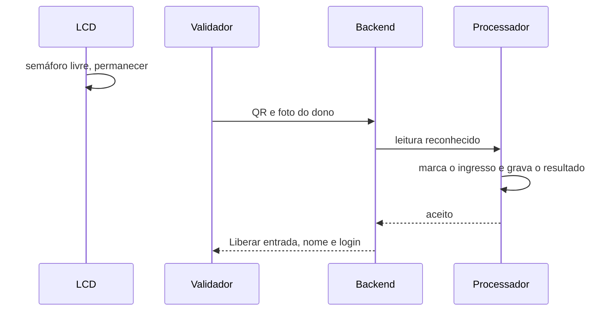
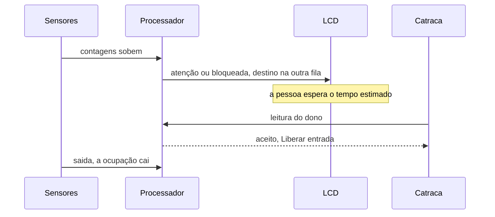
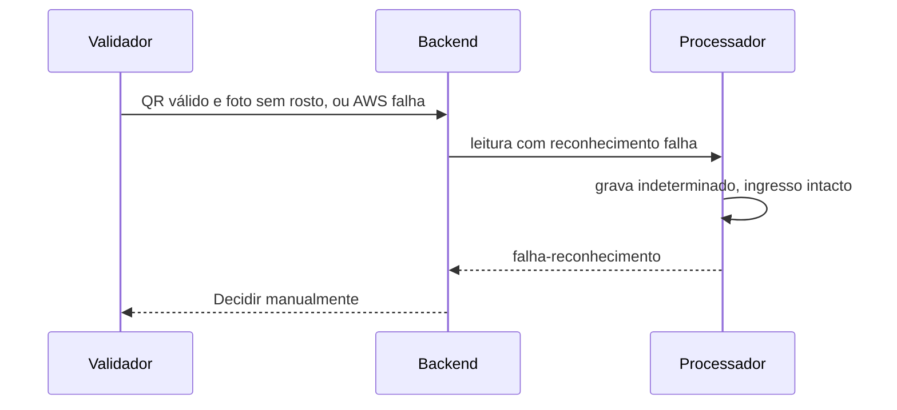
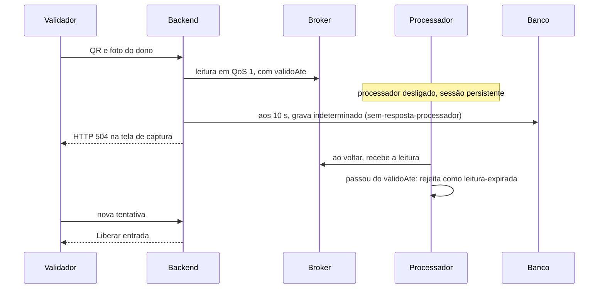

# Caminhos

Quatro fluxos que o código executa. Feliz e comum liberam a entrada. O ruim para na catraca com uma decisão prevista. O não esperado devolve erro e ainda pode gastar o ingresso.

## Feliz

A fila está livre e a catraca reconhece o dono. A pessoa entra na hora.

- Espera de até 15 s: semáforo `livre`, destino é a própria fila.
- Rekognition devolve o dono, com semelhança de pelo menos 95%.
- O processador confirma o papel `validador`, marca o ingresso e grava o resultado na mesma transação.
- O backend responde dentro de 10 s, apaga a foto e devolve nome e login.
- Tela verde: **Liberar entrada**. O sensor de saída reduz a ocupação.

## Comum

Tem gente na fila. A pessoa espera o tempo estimado, muda de fila se o LCD pedir, e entra do mesmo jeito.

- Até duas saídas na janela de 90 s, a espera é ocupação × 7 s. Depois, ocupação dividida pela vazão.
- Acima de 15 s: `atencao`. Acima de 30 s: `bloqueada`, e o destino passa a ser a outra fila em nível melhor.
- Para a cor melhorar, a espera precisa cair 7 s abaixo do limite.
- Na catraca, o aceite é o do caminho feliz.

## Ruim

Raro e previsto. A foto não tem rosto, ou o Rekognition falha. A pessoa não entra sozinha. O ingresso continua válido.

- O backend publica `reconhecimento: falha`.
- O processador grava `indeterminado` com motivo `falha-reconhecimento` e não marca o ingresso.
- A foto fica no bucket por até 1 dia, para o admin revisar.
- Tela âmbar: **Decidir manualmente**. O texto pede para conferir o documento.

Ingresso já usado, cancelado ou rosto de outra pessoa fecha na tela vermelha **Não liberar**, com o motivo. Também é um fluxo previsto, sem erro de sistema.

## Não esperado

O backend está ligado ao broker e o processador não. A catraca recebe erro, e o ingresso continua livre para a nova tentativa.

- O 503 só sai se o próprio backend estiver desconectado do broker. Nesse caso nada é publicado e o ingresso permanece válido.
- Com o broker no ar, a leitura entra na sessão persistente do processador (fila de até 10.000, em disco).
- Aos 10 s o backend grava a leitura como `indeterminado`, motivo `sem-resposta-processador`, e responde 504, «O processador não respondeu. Decida manualmente.».
- O app mostra esse texto como erro na tela de captura. Não abre a tela âmbar de decisão.
- Na volta, o processador descarta a leitura (`leitura-expirada` em `sistema/processador/rejeitado`) e não toca no ingresso. A nova tentativa é uma leitura nova e é decidida normalmente.
- Backend e processador gravam a decisão sob a mesma trava do banco (`travar_leitura`, por `evento_id`). Se o processador decidir no limite dos 10 s, vale quem gravar primeiro: o backend devolve a decisão do processador em vez do 504, ou o processador encontra o `indeterminado` e só o republica.
- O `validoAte` cobre o backend cair durante a espera, sem gravar o `indeterminado`.
